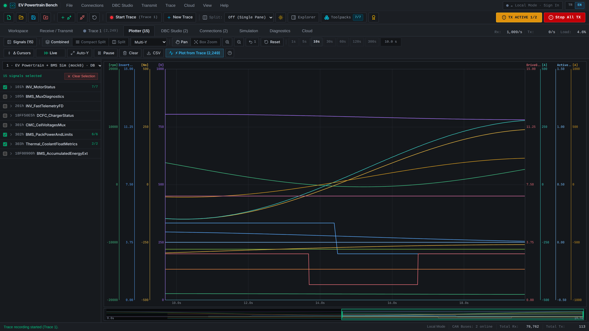
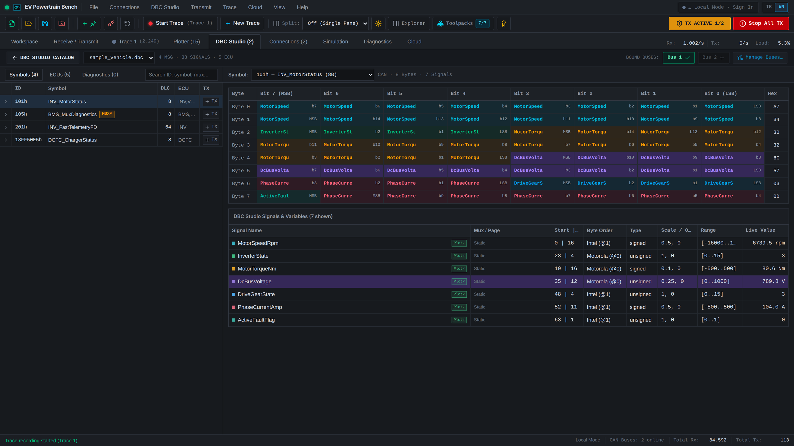
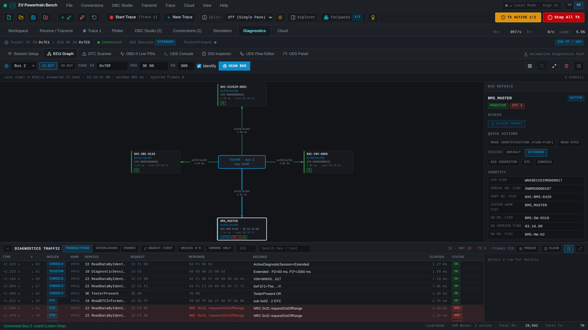
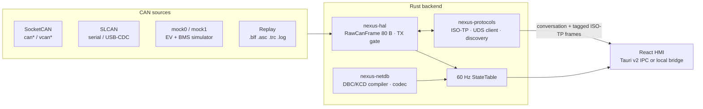

<div align="center">

# NexusCAN

**Open-source CAN / CAN-FD analyzer and UDS diagnostics workbench.**<br/>
Rust core · Tauri v2 desktop · zero-allocation hot path · 100% MIT.

[](https://github.com/kadirtunc/NexusCAN/stargazers)
[](./LICENSE)


<table>
<tr>
<td width="50%"></td>
<td width="50%"></td>
</tr>
<tr>
<td align="center"><sub><b>Bus analysis</b>: live DBC/KCD decoding, CAN-FD, multiplexers, changed-byte highlighting.</sub></td>
<td align="center"><sub><b>UDS diagnostics</b>: one functional request, four ECUs answer, the map grows around you.</sub></td>
</tr>
</table>

<sub>All screenshots are the real app on a virtual network (<code>vcan0</code> + <a href="tests/hil/ecusim">ecusim</a> ECUs + the built-in EV/BMS simulator), reproducible with the steps below.</sub>

</div>

---

## Why NexusCAN

Commercial CAN tools are powerful, expensive and closed. Open-source ones are great at sniffing frames, but stop where diagnostics begins. NexusCAN is a CAN analyzer first, with a diagnostics workbench built on the same core:

- **Fast where it matters.** An 80-byte `#[repr(C)]` frame, no heap allocation on the RX/TX path, and 60 Hz UI snapshots instead of one IPC message per frame.
- **Your database, fully understood.** A 3-stage `.dbc` / `.kcd` compiler: Intel and Motorola bit layouts, signed and IEEE-754 signals, cascaded multiplexers, CAN-FD 64-byte payloads, J1939 PGNs.
- **Safe by default.** Channels open **Listen-Only**. Transmitting needs an explicit, confirmed **Arm**, and **Stop All TX** is one click away on every screen.
- **Diagnostics you can see.** Discover the ECUs on the bus, put them on a map, click one, and every request, response, NRC and ISO-TP frame lines up underneath, each frame tagged by the backend with the exact transaction it belongs to.
- **Real data or nothing.** Outside the clearly badged Demo mode, no view ever fabricates a value.

---

## Tour

### Bus analysis


**Trace** — chronological capture with fully decoded signals (cascaded multiplexers, E2E counters/CRCs), replay with speed control, `.trc` `.asc` `.blf` `.log` `.csv` import and export.

<table>
<tr>
<td width="50%"></td>
<td width="50%"></td>
</tr>
<tr>
<td><b>Plotter</b> — multi-axis live plots on canvas, cursors, overview strip, plot-from-trace.</td>
<td><b>DBC Studio</b> — byte-by-bit layout matrix (Intel and Motorola), scale/offset/range and live value per signal.</td>
</tr>
</table>

**Receive / Transmit** (top of this page) — per-ID overwrite view with live decoding and cycle times; periodic and one-shot TX of raw or signal-encoded frames, values clamped to their DBC range. **Simulation panels** — drag-and-drop instrument panels (gauges, LEDs, plots, buttons, sliders) bound to DBC signals, or generated as a draft straight from a database.

### Safety model


TX state is always visible in the top bar. Disarming is instant; arming a bus takes an explicit confirmation. **Stop All TX** cancels periodic jobs, disarms every bus and closes every diagnostic tap.

### UDS diagnostics workbench



**ECU Graph** — functional discovery (11-bit or 29-bit), automatic identification (VIN, part, serial, SW/HW numbers), per-node DTC count and session. Draggable nodes; the map persists and grows with every scan.


**Traffic Dock** — one pinnable panel under every diagnostics tab. Here a 203-byte `22 F1 F1` response is expanded into its `SF → FF → FC → 29 × CF` frames, with the decoded payload and **P2 / STmin timing checks** on the right. Three views: transactions, interleaved timeline, raw frames.

<table>
<tr>
<td width="50%"></td>
<td width="50%"></td>
</tr>
<tr>
<td><b>DID Inspector</b> — the full ISO 14229-1 Annex C identification range (F180–F19F), ASCII and BCD-date decoding, honest NRCs for what the ECU does not support.</td>
<td><b>UDS Console</b> — any service, physical or functional addressing, and a decoder shared with every other view so the same response always reads the same way.</td>
</tr>
</table>

Also in the box: DTC scanner (`19 02`), OBD-II Mode 01 live PIDs (labelled as OBD, not UDS), a visual UDS flow editor and a drag-and-drop UDS instrument panel.

---

## Try it in five minutes, no hardware needed

Linux with SocketCAN (`vcan` and `can-isotp` kernel modules), Rust and Node.js 20+.

```bash
git clone https://github.com/kadirtunc/NexusCAN.git && cd NexusCAN

# 1. Virtual CAN bus + four virtual UDS ECUs (generic, BMS, inverter, charger)
sudo ./scripts/setup_vcan.sh
sudo modprobe can-isotp
make -C tests/hil/ecusim
cd tests/hil/ecusim
./build/ecusim -i vcan0 -c config/manual.json           --req 0x7E0 --resp 0x7E8 --func 0x7DF &
./build/ecusim -i vcan0 -c config/manual-bms.json       --req 0x7E1 --resp 0x7E9 --func 0x7DF &
./build/ecusim -i vcan0 -c config/manual-inverter.json  --req 0x7E5 --resp 0x7ED --func 0x7DF &
./build/ecusim -i vcan0 -c config/manual-charger.json   --req 0x7E7 --resp 0x7EF --func 0x7DF &
cd ../../..

# 2. Backend and UI (both bind to 127.0.0.1; the UI fetches the bridge token locally)
cargo run --release -p nexus-hal --bin nexus_bridge &   # loopback only, per-run auth token
npm install && npm run dev        # open http://localhost:5173
```

Then: **Create project → Connections → Add Test Simulator (mock0)** for live EV / BMS traffic, add **SocketCAN `vcan0`**, arm it from the **TX** button (top right), and open **Diagnostics → ECU Graph → Scan Bus**.

> The desktop build (Tauri v2) shares the same UI and backend. Cross-platform CI builds are in progress; until they land, the browser mode above is the verified path.

---

## Architecture



| Crate | Responsibility |
|---|---|
| `nexus-core` | `RawCanFrame` (80 B, `Copy`, CAN-FD 64-byte payload), monotonic time |
| `nexus-hal` | Adapter drivers, Listen-Only / Arm / Panic TX gate, diag taps, trace replay, 60 Hz pipeline |
| `nexus-netdb` | 3-stage `.dbc` / `.kcd` compiler, Intel/Motorola/float/cascaded-mux extractor and TX encoder (with clamping) |
| `nexus-protocols` | UDS client (P2/P2*, `0x78`, TesterPresent), functional ECU discovery, ISO-TP capture, seed/key providers |
| `nexus-cli` | Headless agent (always Listen-Only) |

---

## Status

NexusCAN is a **v0.1 preview**. What is real today and what is next, without marketing:

| Area | Available | Next |
|---|---|---|
| Adapters | SocketCAN (Linux), SLCAN (serial, all OS), mock0/mock1 simulators, file replay | **gs_usb / candleLight in pure Rust** (Windows · macOS · Linux, no driver install), PCAN-Basic, Kvaser |
| Safety | Listen-Only default (hardware listen-only on SocketCAN with `CAP_NET_ADMIN`, shown per bus as HW / SW / virtual), confirmed Arm, Stop All TX with explicit Clear Panic, TX gate on every path | Hardware listen-only on every adapter family (gs_usb, PCAN, Kvaser) |
| Diagnostics | UDS client, ECU graph, traffic dock, DID/DTC/console, OBD-II Mode 01, flow editor | Flashing (`34/36/37`), multi-ECU sessions, ODX/CDD, key-provider integration for SecurityAccess |
| Recording | Trace capture and replay, BLF/ASC/TRC/CSV/candump | Lossless backend recorder with triggers, ASAM MF4 |
| Protocols | UDS (ISO 14229), ISO-TP (ISO 15765-2), J1939 PGN decoding via DBC | J1939 transport and DM1/DM2, CANopen, XCP |
| Platforms | Linux (verified), browser mode | Windows and macOS desktop builds via CI |
| Experimental | NexusCloud client and headless agent: in the repo, **off by default** (enable under *View → Experimental: NexusCloud (self-hosted)*) | NexusCloud server preview, agent releases |

### Ecosystem roadmap (experimental)

- **NexusCloud** *(open source, self-hosted)* — team DBC library with semantic diffs, shared recordings, time-series replay.
- **NexusCAN Agent** — headless, always Listen-Only, reachable only through your own NexusCloud. Remote monitoring of test benches and vehicles, with no remote TX by design.

---

## Standing on the shoulders of giants

NexusCAN exists because these projects showed the way, or carry part of the load today:

- **[linux-can / can-utils](https://github.com/linux-can/can-utils)** and the SocketCAN maintainers, for making CAN a first-class network on Linux.
- **[SavvyCAN](https://github.com/collin80/SavvyCAN)** by Collin Kidder, for proving what an open, cross-platform CAN tool can be.
- **[driftregion/iso14229](https://github.com/driftregion/iso14229)** by Nick Kirkby: our entire virtual ECU network runs on it.
- **[`automotive`](https://github.com/I-CAN-hack/automotive)**: the ISO-TP / UDS framing under our UDS client.
- **[udsoncan](https://github.com/pylessard/python-udsoncan)** and **[can-isotp](https://github.com/pylessard/python-can-isotp)** by Pier-Yves Lessard: our independent reference client. Before NexusCAN trusts a virtual ECU, udsoncan has to agree with it.
- **[candleLight / gs_usb](https://github.com/candle-usb/candleLight_fw)**, for affordable open USB-CAN hardware.
- **[cantools](https://github.com/cantools/cantools)**, **[canmatrix](https://github.com/ebroecker/canmatrix)** and **[Kayak](https://github.com/dschanoeh/Kayak)**, for open network-description formats.
- **[PlotJuggler](https://github.com/facontidavide/PlotJuggler)**, for setting the bar on time-series visualization.
- **[Tauri](https://github.com/tauri-apps/tauri)**, **[Tokio](https://github.com/tokio-rs/tokio)**, **[Rhai](https://github.com/rhaiscript/rhai)**, **[React](https://github.com/facebook/react)** and the rest of the Rust and web ecosystem.

Full list with licenses: [ACKNOWLEDGMENTS.md](./ACKNOWLEDGMENTS.md).

---

## Contributing

Issues and pull requests are welcome, especially hardware reports (gs_usb, PCAN, Kvaser on Windows and macOS), protocol expertise (J1939, CANopen, ODX) and real-world traces.

NexusCAN is developed with AI-assisted pair programming (Claude Code). Protocol behaviour is verified against real traffic: SocketCAN `vcan0`, ISO-TP kernel sockets and the `ecusim` HIL test suite.

## Star history

<a href="https://star-history.com/#kadirtunc/NexusCAN&Date">
  
</a>

## License

[MIT](./LICENSE) © Kadir Tunç

<sub>NexusCAN is an independent open-source project and is not affiliated with or endorsed by Vector Informatik, PEAK-System, Kvaser, ETAS, Bosch or SAE International. Product names are trademarks of their respective owners.</sub>
