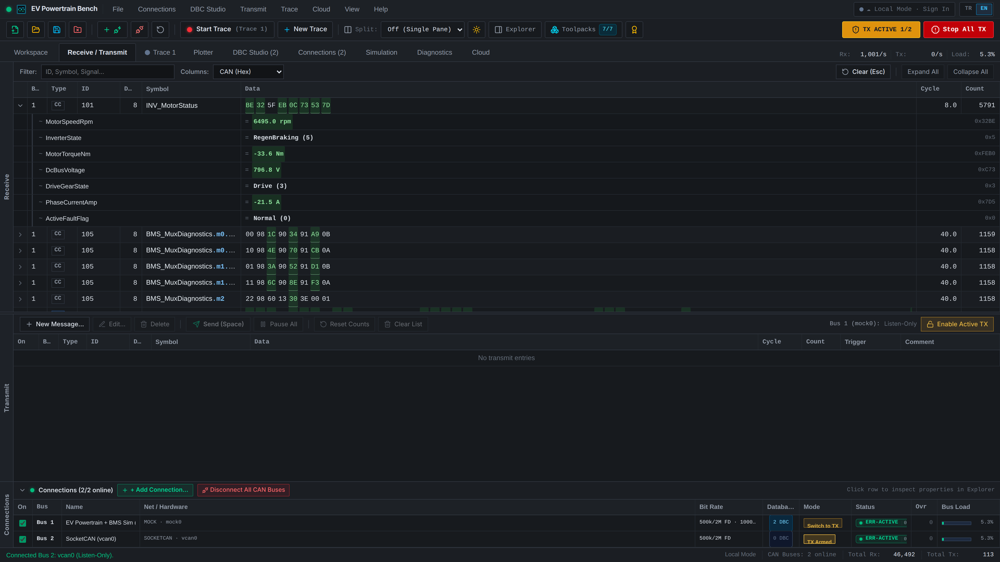
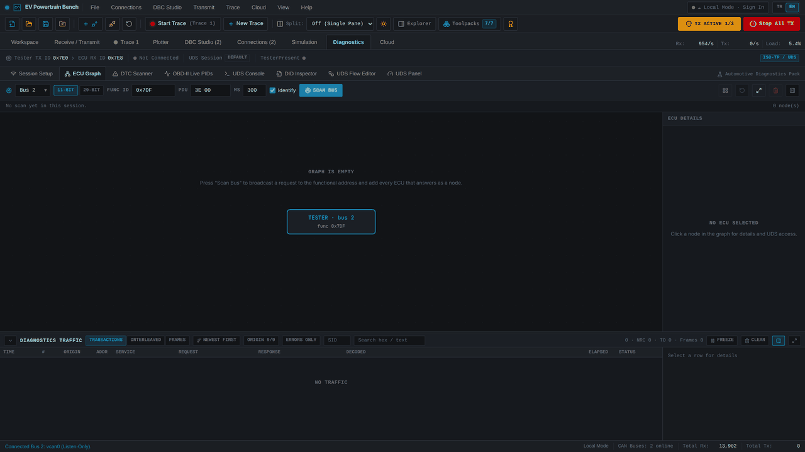
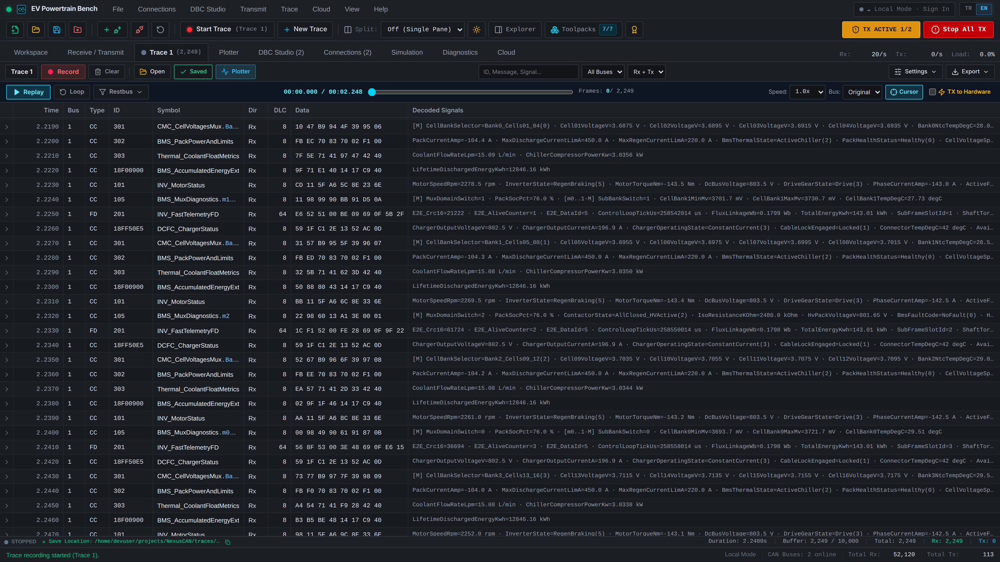
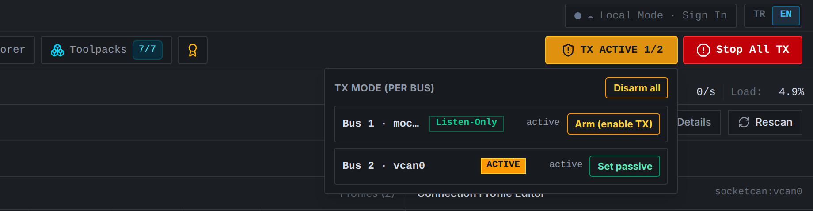
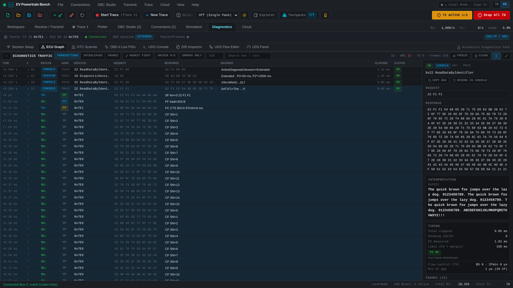
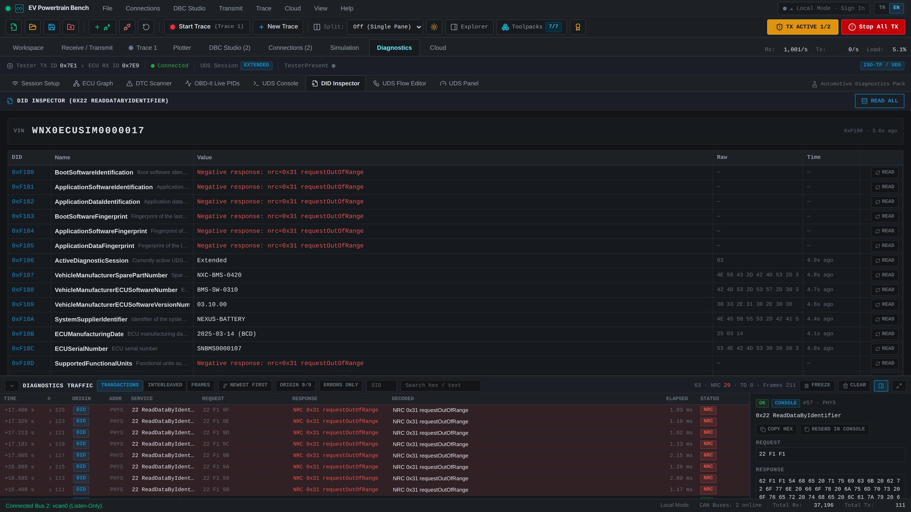
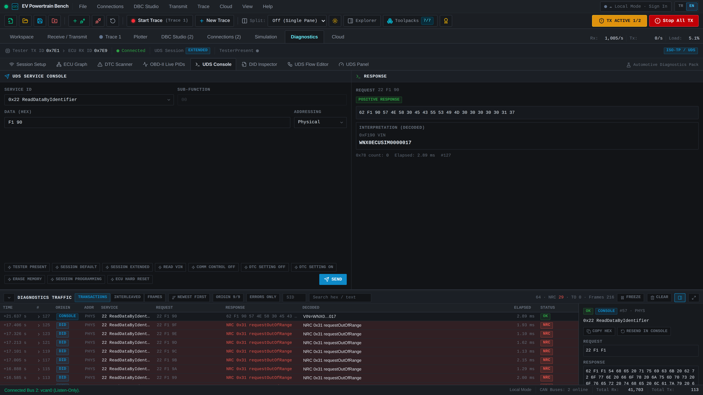
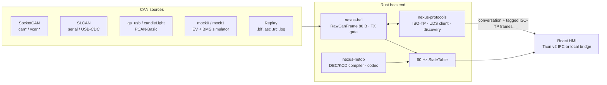

<div align="center">

# NexusCAN

**English** · [Türkçe](./README.tr.md)

**Open-source CAN / CAN-FD analyzer, UDS diagnostics workbench and reverse-engineering toolkit.**<br/>
Rust core · Tauri v2 desktop · zero-allocation hot path · 100% MIT.

[](https://github.com/kadirtunc/NexusCAN/stargazers)
[](https://github.com/sponsors/kadirtunc)
[](./LICENSE)


<table>
<tr>
<td width="50%"></td>
<td width="50%"></td>
</tr>
<tr>
<td align="center"><sub><b>Bus analysis</b>: live DBC/KCD decoding, CAN-FD, multiplexers, changed-byte highlighting.</sub></td>
<td align="center"><sub><b>UDS diagnostics</b>: one functional request, four ECUs answer, the map grows around you.</sub></td>
</tr>
</table>

<sub>All screenshots are the real app on a virtual network (<code>vcan0</code> + <a href="tests/hil/ecusim">ecusim</a> ECUs + the built-in EV/BMS simulator), reproducible with the steps below.</sub>

</div>

---

## Why NexusCAN

Commercial CAN tools are powerful, expensive and closed. Open-source ones are great at sniffing frames, but stop where diagnostics begins. NexusCAN is a CAN analyzer first, with a diagnostics workbench built on the same core:

- **Fast where it matters.** An 80-byte `#[repr(C)]` frame, no heap allocation on the RX/TX path, and 60 Hz UI snapshots instead of one IPC message per frame.
- **Your database, fully understood.** A 3-stage `.dbc` / `.kcd` compiler: Intel and Motorola bit layouts, signed and IEEE-754 signals, cascaded multiplexers, CAN-FD 64-byte payloads, J1939 PGNs.
- **Safe by default.** Channels open **Listen-Only**. Transmitting needs an explicit, confirmed **Arm**, and **Stop All TX** is one click away on every screen.
- **Diagnostics you can see.** Discover the ECUs on the bus, put them on a map, click one, and every request, response, NRC and ISO-TP frame lines up underneath, each frame tagged by the backend with the exact transaction it belongs to.
- **Reverse engineering built in.** Bit-level toggle heatmaps, baseline → action diffs, a field classifier, signal correlation against OBD-II and a Cheat-Engine-style value scan. Every signal you find can be saved straight to a DBC.
- **Real data or nothing.** Outside the clearly badged Demo mode, no view ever fabricates a value.

---

## Download

Ready-to-run builds for every push to `main` are on the **[Releases](https://github.com/kadirtunc/NexusCAN/releases)** page. They are published only after the full CI gate (clippy, Rust and frontend tests, Tauri build) has passed on all three operating systems.

| Platform | Files |
| :--- | :--- |
| Windows 10/11 x64 | `*_x64-setup.exe` (installer), `*.msi`, `*_x64_portable.exe` (no install needed) |
| Linux x86_64 | `*.AppImage` (`chmod +x` and run), `*.deb`, `*.rpm` |
| macOS (Apple Silicon) | `*_aarch64.dmg` |

Builds are not code-signed yet. On Windows, SmartScreen asks you to confirm ("Run anyway"). On macOS, run `xattr -cr /Applications/NexusCAN.app` once after copying the app. Every release ships a `SHA256SUMS.txt`.

---

## Tour

### Bus analysis



**Trace** — chronological capture with fully decoded signals (cascaded multiplexers, E2E counters/CRCs), replay with speed control, `.trc` `.asc` `.blf` `.log` `.csv` import and export.

<table>
<tr>
<td width="50%"></td>
<td width="50%"></td>
</tr>
<tr>
<td><b>Plotter</b> — multi-axis live plots on canvas, cursors, overview strip, plot-from-trace.</td>
<td><b>DBC Studio</b> — byte-by-bit layout matrix (Intel and Motorola), scale/offset/range and live value per signal.</td>
</tr>
</table>

**Error frames and bus health** — CAN error frames are decoded into readable causes (bit, stuff, form, ACK, CRC errors, error-passive / bus-off transitions), and frames can be copied and pasted as text lines (id, standard/extended, FD/BRS, length, data). **Connections dock** — every bus with its adapter, mode and health in a bottom dock. **Debug console** — a detachable window with categorized, rate-limited backend and UI events.

**Receive / Transmit** (top of this page) — per-ID overwrite view with live decoding and cycle times; periodic and one-shot TX of raw or signal-encoded frames, values clamped to their DBC range. **Simulation panels** — drag-and-drop instrument panels (gauges, LEDs, plots, buttons, sliders) bound to DBC signals, or generated as a draft straight from a database.

### Safety model



TX state is always visible in the top bar. Disarming is instant; arming a bus takes an explicit confirmation. **Stop All TX** cancels periodic jobs, disarms every bus and closes every diagnostic tap. It returns only after any write that had already passed the TX gate has finished (bounded at 250 ms and reported if exceeded), which is verified on `vcan0` by an independent raw-socket sniffer: 1000 races, zero frames after Panic Stop.

- **Fail-closed hardware Listen-Only (opt-in).** Per connection, *Require hardware Listen-Only* refuses to open a physical channel that can only offer a software TX lock. The badge shows what each bus really has: hardware, software or virtual.
- **Honest adapters.** The SLCAN driver reads the adapter's reply to the Lawicel listen-only command instead of assuming it. Virtual SocketCAN interfaces are detected from kernel facts, never from the interface name.

### UDS diagnostics workbench


**ECU Graph** — functional discovery (11-bit or 29-bit), automatic identification (VIN, part, serial, SW/HW numbers), per-node DTC count and session. Draggable nodes; the map persists and grows with every scan.



**Traffic Dock** — one pinnable panel under every diagnostics tab. Here a 203-byte `22 F1 F1` response is expanded into its `SF → FF → FC → 29 × CF` frames, with the decoded payload and **P2 / STmin timing checks** on the right. Three views: transactions, interleaved timeline, raw frames.

<table>
<tr>
<td width="50%"></td>
<td width="50%"></td>
</tr>
<tr>
<td><b>DID Inspector</b> — the full ISO 14229-1 Annex C identification range (F180–F19F), ASCII and BCD-date decoding, honest NRCs for what the ECU does not support.</td>
<td><b>UDS Console</b> — any service, physical or functional addressing, and a decoder shared with every other view so the same response always reads the same way.</td>
</tr>
</table>

**Discovery without transmitting** — *passive discovery* finds tester ↔ ECU pairs from traffic alone, works under Listen-Only and survives Panic Stop. When you do want to probe, the *physical sweep* scans request ids strictly one at a time through the gated TX path and stops with a partial result on Panic Stop or disarm. 11-bit, 29-bit and the ISO 15765-2 addressing formats are supported.

**DTC reports** — `0x19` ReadDTCInformation report types with status-mask decoding, next to the classic DTC scanner (`19 02`).

**ECU programming** — UDS flashing pipeline (`34` RequestDownload / `36` TransferData / `37` RequestTransferExit) with a bootloader simulator and `vcan0` end-to-end tests. Stop and Panic Stop are honoured while the image is loading: nothing is erased or downloaded after a stop.

**SecurityAccess key providers** — seed/key profiles with built-in algorithms, vendor `GenerateKeyEx` DLLs/shared libraries run in an isolated 32/64-bit helper process (a crashing vendor library cannot take the app down), external processes or an HTTP service.

**ECU registry** — vehicles, groups and ECU records (addressing, session and security settings) stored in the project, with field-level validation, `{ecu.*}` variables for flows and `.nexusecu.json` import/export.

**Flow Editor** — a protocol-agnostic visual block editor (renamed from the UDS flow editor). It includes variables, math, logic, loops and text blocks, and UDS, flash and log blocks. Flows behave like Simulink blocks: typed `flow_in` / `flow_out` ports with units and ranges, bindable parameters, and outcomes such as `ok` / `safe_abort` / `error`. Any selection can become a reusable custom block, and blocks can be nested. Every saved flow is an immutable revision in the flow library.

**Workbench** — the operations view: rows are the ECUs of the active vehicle, columns are the blocks bound to them. Run one cell, see its outcome and outputs, open the full run record (parameters, files, outputs, log excerpt). Every Workbench run is appended to a per-project, append-only run store.

**Diagnostic Simulation** (formerly UDS Panel) — saved drag-and-drop instrument panels bound to UDS DIDs **or OBD-II Mode 01 PIDs**, kept in the project file with import/export. Panels never poll or write until you press Run.

Also in the box: OBD-II Mode 01 live PIDs (labelled as OBD, not UDS) and the UDS Console.

### Reverse engineering (car hacking)

A dedicated **Reverse Engineering** tab for finding undocumented signals. It is passive only: nothing here transmits, and it runs on live buses (SocketCAN, adapters, the bridge) as well as on the clearly badged Demo source.

- **Sniffer heatmap** — one row per ID, eight cells per byte, colour = how often each bit toggles. Bit values and byte hex are shown under every cell, and CAN-FD rows cover all 512 bits. Rendered on Canvas, it stays at zero dropped frames at 50 000 frames/s.
- **Baseline → Action diff** — record a *Baseline* while nothing happens, then an *Action* while you press the button or open the door. Only the bits that moved during the action stay highlighted; counters, checksums and sensor noise are muted automatically. Event markers (`M`) stamp moments on the timeline.
- **Field classifier** — per-bit entropy plus automatic detection of constant bits, rolling counters (2/4/8-bit), checksums (XOR8, SUM8, CRC8 SAE-J1850, CRC8 AUTOSAR 0x2F), flags and physical values (Intel vs Motorola chosen by smoothness), with period and jitter per ID.
- **Signal Inspector** — select bits on a byte × bit grid and see up to four candidate interpretations (length, byte order, signed, float32/64, factor/offset) plotted live. All bit math comes from the same compiled-DBC engine used everywhere else.
- **Correlation search** — against an OBD-II PID decoded from responses on the bus, numeric values at your markers, or another candidate. An exhaustive sweep (every start bit × length × byte order × sign, about 6 200 candidates for a classic frame in about 0.1 s) ranks fields by |r|, fits factor/offset by least squares and finds time lags of up to ±500 ms.
- **Save to DBC** — a found signal becomes a draft (name, scaling, range, unit, value table, plus provenance such as `RE: r=0.998 lag=+120ms ref=OBD 0x0D`) kept in the project. *Apply to bus* loads all drafts as `RE_found.dbc` so the trace, inspector and plots decode them immediately. *Export .dbc* writes a standalone file, and *Merge into DBC…* adds them to an existing database as a new file. Every generated DBC is re-parsed and verified bit-for-bit before it is offered.
- **Value Scan** — Cheat Engine for CAN: scan for an exact, physical (with scale presets such as ×0.01 or −40 offset), range or unknown value, change something on the vehicle, then narrow with *changed / unchanged / increased / decreased / increased by N / stable for T ms* until the signal is left. Values can be typed in decimal or `0x` hex. Undo goes back up to eight steps, and identically moving nested fields are grouped. A million candidates are scanned in about 50 ms; any result opens in the Signal Inspector or saves to DBC.

### AI co-pilot (MCP server)

NexusCAN has a built-in [Model Context Protocol](https://modelcontextprotocol.io) server, so an AI assistant such as Claude Code can read what the analyzer sees and answer questions about it: *"Which IDs are the busiest on bus 0?"*, *"Summarise BMS_Status over the last 10 s"*, *"Interpret the DTC responses in this session"*, *"Compare the last two recordings"*.

It is **off by default**. Start it from the `MCP` indicator in the status bar, then connect your client with the command the panel copies for you:

```bash
claude mcp add --transport http nexuscan http://127.0.0.1:17800/mcp \
  --header "Authorization: Bearer <TOKEN>"
```

**46 read-only tools** in eight groups:

| Group | Tools | What the assistant can do |
| :--- | :---: | :--- |
| Live | 9 | App and bus status, devices and drivers, live message table, live signal values and statistics, periodic TX list, recent trace window |
| Trace | 4 | List, summarise and query recordings, extract a signal as a time series |
| Database | 8 | Loaded DBC/KCD info, signal search, messages and ECUs, decode / encode a frame, parser diagnostics |
| Diagnostics | 4 | UDS session info, request/response conversation, ISO-TP frames, passive ECU discovery |
| Reverse engineering | 6 | Heatmap status, bit series, correlation, Value Scan results, generate a DBC draft |
| Workspace | 4 | Projects, trace comparison, Debug Console events |
| Runs & flows | 4 | Workbench run history, flow library |
| UI co-pilot | 7 | Read the UI state, switch tabs, select a message, set the Trace filter, add signals to the Plotter, show a notification, ask you a yes/no question |

**Safety.** No MCP tool can transmit, arm a bus, change the bus mode, run UDS services, flash, compute seed/keys, start a replay or write files; Listen-Only and Panic Stop are untouched. The server binds to `127.0.0.1` only, requires a fresh random token on every start, rejects non-loopback `Host`/`Origin`, logs every call to the Debug Console (category `MCP`) and redacts SecurityAccess / Authentication data. It stops when the main window closes. Click ⓘ in the MCP panel for the full tool list with descriptions.

---

## Try it in five minutes, no hardware needed

Linux with SocketCAN (`vcan` and `can-isotp` kernel modules), Rust and Node.js 20+.

```bash
git clone https://github.com/kadirtunc/NexusCAN.git && cd NexusCAN

# 1. Virtual CAN bus + four virtual UDS ECUs (generic, BMS, inverter, charger)
sudo ./scripts/setup_vcan.sh
sudo modprobe can-isotp
make -C tests/hil/ecusim
cd tests/hil/ecusim
./build/ecusim -i vcan0 -c config/manual.json           --req 0x7E0 --resp 0x7E8 --func 0x7DF &
./build/ecusim -i vcan0 -c config/manual-bms.json       --req 0x7E1 --resp 0x7E9 --func 0x7DF &
./build/ecusim -i vcan0 -c config/manual-inverter.json  --req 0x7E5 --resp 0x7ED --func 0x7DF &
./build/ecusim -i vcan0 -c config/manual-charger.json   --req 0x7E7 --resp 0x7EF --func 0x7DF &
cd ../../..

# 2. Backend and UI (both bind to 127.0.0.1; the UI fetches the bridge token locally)
cargo run --release -p nexus-hal --bin nexus_bridge &   # loopback only, per-run auth token
npm install && npm run dev        # open http://localhost:5173
```

Then: **Create project → Connections → Add Test Simulator (mock0)** for live EV / BMS traffic, add **SocketCAN `vcan0`**, arm it from the **TX** button (top right), and open **Diagnostics → ECU Graph → Scan Bus**.

> The desktop build (Tauri v2) shares the same UI and backend; installers for Windows, Linux and macOS are on the [Releases](https://github.com/kadirtunc/NexusCAN/releases) page (see [Download](#download)). The browser mode above is the path verified end-to-end against `vcan0`.

---

## Architecture



| Crate | Responsibility |
|---|---|
| `nexus-core` | `RawCanFrame` (80 B, `Copy`, CAN-FD 64-byte payload), monotonic time |
| `nexus-hal` | Adapter drivers, Listen-Only / Arm / Panic TX gate, diag taps (passive discovery, sweep, DTC, flash), trace replay, 60 Hz pipeline, reverse-engineering analyzer, flow library and run store |
| `nexus-netdb` | 3-stage `.dbc` / `.kcd` compiler, Intel/Motorola/float/cascaded-mux extractor and TX encoder (with clamping), DBC writer and RE signal export |
| `nexus-protocols` | UDS client (P2/P2*, `0x78`, TesterPresent), functional ECU discovery, ISO-TP capture, seed/key providers |
| `nexus-protocols` (cont.) | SAE J1939: 29-bit id/PGN codec, BAM and CMDT transport reassembly, address claim, DM1/DM2; UDS flashing sequence |
| `nexus-seedkey-native` / `-host` | Out-of-process SecurityAccess key providers (vendor DLL/SO isolation, external process, HTTP) |
| `nexus-ecu-sim` | UDS ECU and bootloader simulator for HIL and flashing tests |
| `nexus-cli` | Headless agent (always Listen-Only) |

---

## Status

NexusCAN is a **v0.1 preview**. What is real today and what is next, without marketing. Every release is listed in [CHANGELOG.md](CHANGELOG.md) (also in the app under **Help → Changelog**).

| Area | Available | Next |
|---|---|---|
| Adapters | SocketCAN (Linux), SLCAN (serial, all OS), mock0/mock1 simulators, file replay; **gs_usb / candleLight in pure Rust** (`nusb`, no driver install) and **PCAN-Basic** (runtime-loaded, app starts without it) drivers in the tree | Hardware reports for gs_usb and PCAN on Windows / macOS, Kvaser, Vector XL |
| Safety | Listen-Only default (shown per bus as HW / SW / virtual), opt-in fail-closed hardware Listen-Only, confirmed Arm, Stop All TX that waits for in-flight writes, explicit Clear Panic, TX gate on every path | Hardware listen-only verified on every adapter family |
| Diagnostics | UDS client, ECU graph, passive discovery, physical sweep, traffic dock, DID / `0x19` DTC reports / console, OBD-II Mode 01, flashing (`34/36/37`), seed/key providers, ECU registry, Flow Editor, Workbench (single-cell runs), Diagnostic Simulation panels | Workbench queues and report export, multi-ECU procedures, ODX/CDD |
| Recording | Trace capture and replay, BLF/ASC/TRC/CSV/candump | Lossless backend recorder with triggers, ASAM MF4 |
| Reverse engineering | Sniffer heatmap, baseline/action diff, field classifier, Signal Inspector, correlation search, save to DBC, Value Scan | Offline analysis of recorded logs, two-log diff, selective replay, active scanners (gated) |
| Protocols | UDS (ISO 14229), ISO-TP (ISO 15765-2 incl. addressing formats), SAE J1939 (PGN codec, BAM/CMDT transport, address claim, DM1/DM2) | J1939 UI, CANopen, XCP |
| Platforms | Linux (verified), browser mode; Windows, Linux and macOS (Apple Silicon) desktop builds published automatically from CI | Code signing / notarization, Intel macOS build |
| Experimental | NexusCloud client and headless agent: code in the repo, **disabled in release builds** | NexusCloud server preview, agent releases |

### Ecosystem roadmap (experimental)

- **NexusCloud** *(open source, self-hosted)* — team DBC library with semantic diffs, shared recordings, time-series replay.
- **NexusCAN Agent** — headless, always Listen-Only, reachable only through your own NexusCloud. Remote monitoring of test benches and vehicles, with no remote TX by design.

---

## Standing on the shoulders of giants

NexusCAN exists because these projects showed the way, or carry part of the load today:

- **[linux-can / can-utils](https://github.com/linux-can/can-utils)** and the SocketCAN maintainers, for making CAN a first-class network on Linux.
- **[SavvyCAN](https://github.com/collin80/SavvyCAN)** by Collin Kidder, for proving what an open, cross-platform CAN tool can be.
- **[driftregion/iso14229](https://github.com/driftregion/iso14229)** by Nick Kirkby: our entire virtual ECU network runs on it.
- **[`automotive`](https://github.com/I-CAN-hack/automotive)**: the ISO-TP / UDS framing under our UDS client.
- **[udsoncan](https://github.com/pylessard/python-udsoncan)** and **[can-isotp](https://github.com/pylessard/python-can-isotp)** by Pier-Yves Lessard: our independent reference client. Before NexusCAN trusts a virtual ECU, udsoncan has to agree with it.
- **[candleLight / gs_usb](https://github.com/candle-usb/candleLight_fw)**, for affordable open USB-CAN hardware.
- **[cantools](https://github.com/cantools/cantools)**, **[canmatrix](https://github.com/ebroecker/canmatrix)** and **[Kayak](https://github.com/dschanoeh/Kayak)**, for open network-description formats.
- **[PlotJuggler](https://github.com/facontidavide/PlotJuggler)**, for setting the bar on time-series visualization.
- **[Tauri](https://github.com/tauri-apps/tauri)**, **[Tokio](https://github.com/tokio-rs/tokio)**, **[Rhai](https://github.com/rhaiscript/rhai)**, **[React](https://github.com/facebook/react)** and the rest of the Rust and web ecosystem.

Special thanks to **[@emrylmzkk](https://github.com/emrylmzkk)** for supporting the project.

Full list with licenses: [ACKNOWLEDGMENTS.md](./ACKNOWLEDGMENTS.md).

---

## Contributing

Issues and pull requests are welcome, especially hardware reports (gs_usb, PCAN, Kvaser on Windows and macOS), protocol expertise (J1939, CANopen, ODX) and real-world traces.

NexusCAN is developed with AI-assisted pair programming (Claude Code). Protocol behaviour is verified against real traffic: SocketCAN `vcan0`, ISO-TP kernel sockets and the `ecusim` HIL test suite.

## Contact

If NexusCAN saves you time or money, consider **[sponsoring the project on GitHub](https://github.com/sponsors/kadirtunc)**: it directly funds hardware for testing (gs_usb, PCAN, Kvaser, real UDS ECUs) and development time.

For **job offers, sponsorship, collaboration or commercial support**, email **[kdrtnc35@gmail.com](mailto:kdrtnc35@gmail.com)**.

For bugs and feature requests, please open a [GitHub issue](https://github.com/kadirtunc/NexusCAN/issues) instead, so everyone can benefit from the answer. To report a security issue, see [SECURITY.md](./SECURITY.md).

## Star history

<a href="https://star-history.com/#kadirtunc/NexusCAN&Date">
  
</a>

## License

[MIT](./LICENSE) © Kadir Tunç

<sub>NexusCAN is an independent open-source project and is not affiliated with or endorsed by Vector Informatik, PEAK-System, Kvaser, ETAS, Bosch or SAE International. Product names are trademarks of their respective owners.</sub>
