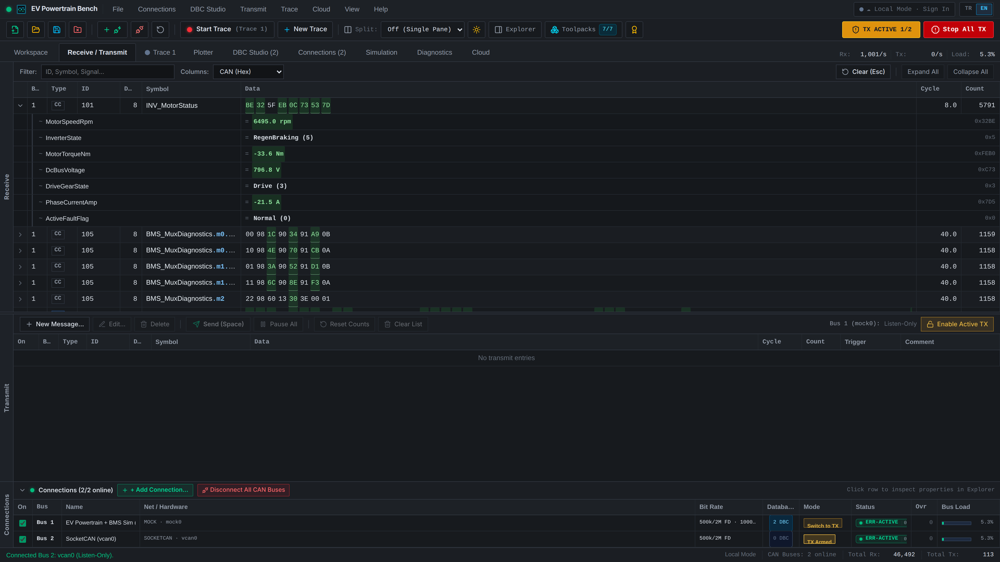
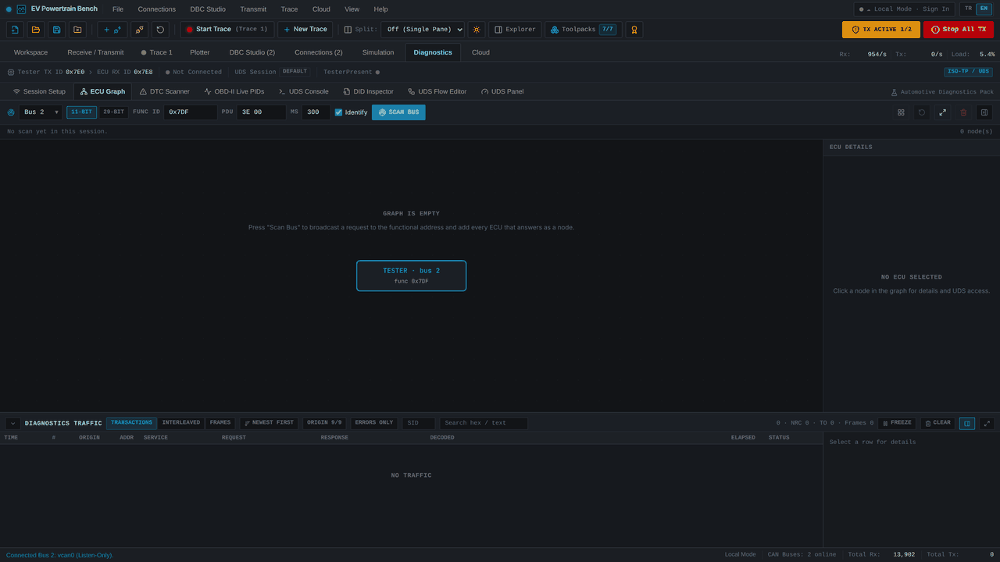
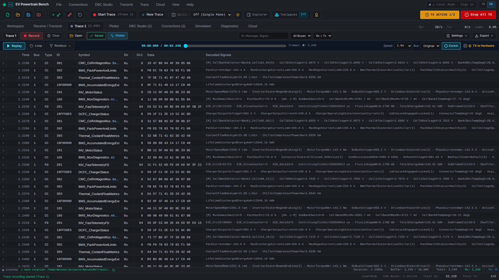
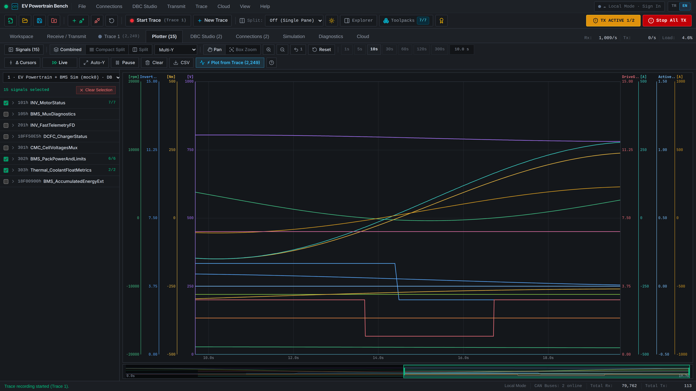
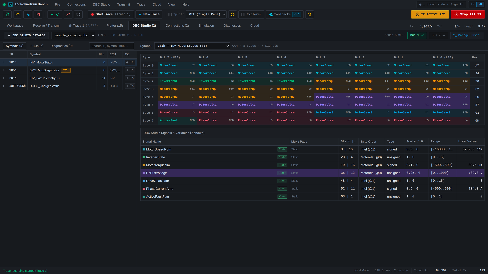
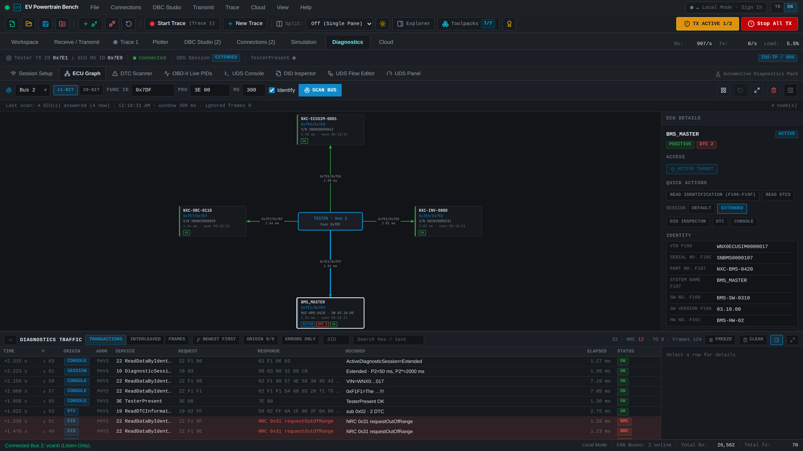
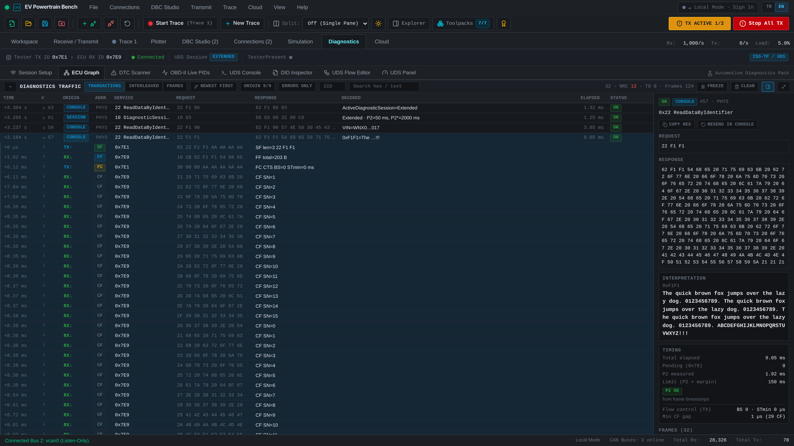
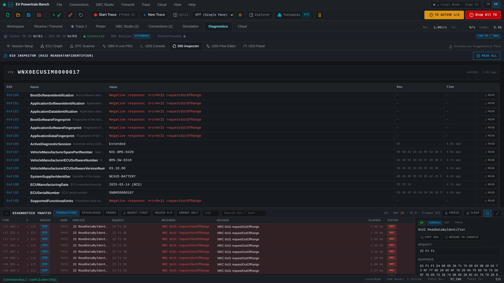
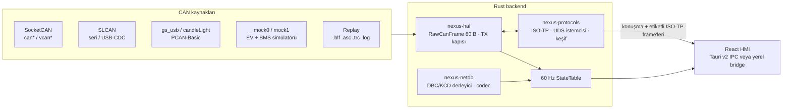

<div align="center">

# NexusCAN

[English](./README.md) · **Türkçe**

**Açık kaynaklı CAN / CAN-FD analizörü, UDS tanılama tezgâhı ve tersine mühendislik araç seti.**<br/>
Rust çekirdek · Tauri v2 masaüstü · sıcak hatta sıfır bellek tahsisi · %100 MIT.

[](https://github.com/kadirtunc/NexusCAN/stargazers)
[](https://github.com/sponsors/kadirtunc)
[](./LICENSE)


<table>
<tr>
<td width="50%"></td>
<td width="50%"></td>
</tr>
<tr>
<td align="center"><sub><b>Bus analizi</b>: canlı DBC/KCD çözümleme, CAN-FD, multiplexer'lar, değişen bayt vurgulama.</sub></td>
<td align="center"><sub><b>UDS tanılama</b>: tek fonksiyonel istek, dört ECU yanıt verir, harita etrafınızda büyür.</sub></td>
</tr>
</table>

<sub>Tüm ekran görüntüleri, sanal bir ağ üzerinde çalışan gerçek uygulamaya aittir (<code>vcan0</code> + <a href="tests/hil/ecusim">ecusim</a> ECU'ları + yerleşik EV/BMS simülatörü) ve aşağıdaki adımlarla yeniden üretilebilir.</sub>

</div>

---

## Neden NexusCAN

Ticari CAN araçları güçlü, pahalı ve kapalı. Açık kaynaklı olanlar frame dinlemede çok iyi, ama tanılamanın başladığı yerde duruyorlar. NexusCAN önce bir CAN analizörü; tanılama tezgâhı da aynı çekirdeğin üzerine kurulu:

- **Önemli olan yerde hızlı.** 80 baytlık `#[repr(C)]` frame, RX/TX hattında heap tahsisi yok, frame başına bir IPC mesajı yerine saniyede 60 arayüz anlık görüntüsü.
- **Veritabanınız tamamen anlaşılır.** 3 aşamalı `.dbc` / `.kcd` derleyici: Intel ve Motorola bit yerleşimleri, işaretli ve IEEE-754 sinyaller, kademeli multiplexer'lar, 64 baytlık CAN-FD yükleri, J1939 PGN'leri.
- **Varsayılan olarak güvenli.** Kanallar **Listen-Only** (yalnızca dinleme) modunda açılır. Veri göndermek için açık ve onaylanmış bir **Arm** gerekir; **Stop All TX** her ekranda tek tık uzaklıktadır.
- **Görülebilen tanılama.** Bus'taki ECU'ları keşfedin, haritaya yerleştirin, birine tıklayın: her istek, yanıt, NRC ve ISO-TP frame'i altında sıralanır, her frame backend tarafından ait olduğu işlemle etiketlenir.
- **Tersine mühendislik yerleşik.** Bit düzeyinde değişim ısı haritaları, baseline → action farkları, alan sınıflandırıcı, OBD-II'ye karşı sinyal korelasyonu ve Cheat Engine tarzı değer tarama. Bulduğunuz her sinyal doğrudan DBC'ye kaydedilebilir.
- **Gerçek veri ya da hiç.** Açıkça etiketlenmiş Demo modu dışında hiçbir görünüm uydurma değer göstermez.

---

## İndir

`main`'e yapılan her push için çalışmaya hazır build'ler **[Releases](https://github.com/kadirtunc/NexusCAN/releases)** sayfasındadır. Yalnızca CI kapısının tamamı (clippy, Rust ve frontend testleri, Tauri build) üç işletim sisteminde de geçtikten sonra yayınlanırlar.

| Platform | Dosyalar |
| :--- | :--- |
| Windows 10/11 x64 | `*_x64-setup.exe` (kurulum), `*.msi`, `*_x64_portable.exe` (kurulum gerektirmez) |
| Linux x86_64 | `*.AppImage` (`chmod +x` yapıp çalıştırın), `*.deb`, `*.rpm` |
| macOS (Apple Silicon) | `*_aarch64.dmg` |

Build'ler henüz kod imzalı değil. Windows'ta SmartScreen onay ister ("Yine de çalıştır"). macOS'ta uygulamayı kopyaladıktan sonra bir kez `xattr -cr /Applications/NexusCAN.app` çalıştırın. Her release bir `SHA256SUMS.txt` dosyası içerir.

---

## Tur

### Bus analizi



**Trace**: tamamen çözümlenmiş sinyallerle kronolojik kayıt (kademeli multiplexer'lar, E2E sayaçları/CRC'leri), hız kontrollü yeniden oynatma, `.trc` `.asc` `.blf` `.log` `.csv` içe ve dışa aktarma.

<table>
<tr>
<td width="50%"></td>
<td width="50%"></td>
</tr>
<tr>
<td><b>Plotter</b>: canvas üzerinde çok eksenli canlı grafikler, imleçler, genel bakış şeridi, trace'ten grafik.</td>
<td><b>DBC Studio</b>: bayt-bit yerleşim matrisi (Intel ve Motorola), sinyal başına ölçek/ofset/aralık ve canlı değer.</td>
</tr>
</table>

**Hata frame'leri ve bus sağlığı**: CAN hata frame'leri okunabilir sebeplere çözümlenir (bit, stuff, form, ACK, CRC hataları, error-passive / bus-off geçişleri); frame'ler metin satırı olarak kopyalanıp yapıştırılabilir (id, standart/extended, FD/BRS, uzunluk, veri). **Connections dock**: her bus, adaptörü, modu ve sağlık durumuyla alttaki panelde. **Debug console**: kategorilere ayrılmış, hız sınırlı backend ve arayüz olaylarını gösteren, ayrılabilir bir pencere.

**Receive / Transmit** (sayfanın başındaki görüntü): canlı çözümleme ve döngü süreleriyle ID başına üzerine yazan görünüm; ham veya sinyal kodlu frame'lerin periyodik ve tek seferlik gönderimi, değerler DBC aralığına kırpılır. **Simülasyon panelleri**: DBC sinyallerine bağlanan sürükle-bırak gösterge panelleri (göstergeler, LED'ler, grafikler, butonlar, sürgüler) ya da doğrudan bir veritabanından taslak olarak oluşturulan paneller.

### Güvenlik modeli


TX durumu üst çubukta her zaman görünür. Disarm anında gerçekleşir; bir bus'ı arm etmek açık bir onay gerektirir. **Stop All TX** periyodik işleri iptal eder, tüm bus'ları disarm eder ve tüm tanılama bağlantılarını kapatır. TX kapısından geçmiş olan yazmalar bitmeden geri dönmez (en fazla 250 ms, aşılırsa raporlanır). Bu, `vcan0` üzerinde bağımsız bir raw-socket dinleyicisiyle doğrulanmıştır: 1000 yarış, Panic Stop sonrasında sıfır frame.

- **Fail-closed donanım Listen-Only (isteğe bağlı).** Bağlantı başına *Require hardware Listen-Only* seçeneği, yalnızca yazılımsal TX kilidi sunabilen fiziksel bir kanalın açılmasını reddeder. Rozet her bus'ın gerçekte neye sahip olduğunu gösterir: donanım, yazılım veya sanal.
- **Dürüst adaptörler.** SLCAN sürücüsü, Lawicel listen-only komutuna adaptörün verdiği yanıtı varsaymak yerine okur. Sanal SocketCAN arayüzleri arayüz adından değil, kernel bilgilerinden tespit edilir.

### UDS tanılama tezgâhı



**ECU Graph**: fonksiyonel keşif (11-bit veya 29-bit), otomatik kimlik tespiti (VIN, parça, seri, SW/HW numaraları), düğüm başına DTC sayısı ve oturum. Sürüklenebilir düğümler; harita kalıcıdır ve her taramayla büyür.



**Traffic Dock**: her tanılama sekmesinin altında sabitlenebilen tek bir panel. Burada 203 baytlık bir `22 F1 F1` yanıtı `SF → FF → FC → 29 × CF` frame'lerine açılmış; sağda çözümlenmiş veri ve **P2 / STmin zamanlama kontrolleri** var. Üç görünüm: işlemler, iç içe zaman çizelgesi, ham frame'ler.

<table>
<tr>
<td width="50%"></td>
<td width="50%"></td>
</tr>
<tr>
<td><b>DID Inspector</b>: ISO 14229-1 Annex C kimlik aralığının tamamı (F180–F19F), ASCII ve BCD tarih çözümleme, ECU'nun desteklemediği DID'ler için dürüst NRC'ler.</td>
<td><b>UDS Console</b>: her servis, fiziksel veya fonksiyonel adresleme ve diğer tüm görünümlerle ortak bir çözümleyici; aynı yanıt her yerde aynı şekilde okunur.</td>
</tr>
</table>

**Veri göndermeden keşif**: *pasif keşif* tester ↔ ECU çiftlerini yalnızca trafikten bulur, Listen-Only altında çalışır ve Panic Stop'tan etkilenmez. Aktif olarak yoklamak istediğinizde *fiziksel tarama*, istek ID'lerini kontrollü TX hattı üzerinden kesinlikle birer birer tarar; Panic Stop veya disarm durumunda kısmi sonuçla durur. 11-bit, 29-bit ve ISO 15765-2 adresleme formatları desteklenir.

**DTC raporları**: durum maskesi çözümlemeli `0x19` ReadDTCInformation rapor türleri ve klasik DTC tarayıcı (`19 02`).

**ECU programlama**: bootloader simülatörü ve `vcan0` uçtan uca testleriyle UDS flashlama hattı (`34` RequestDownload / `36` TransferData / `37` RequestTransferExit). İmaj yüklenirken Stop ve Panic Stop dikkate alınır: durdurmadan sonra hiçbir şey silinmez veya indirilmez.

**SecurityAccess anahtar sağlayıcıları**: yerleşik algoritmalarla seed/key profilleri; üretici `GenerateKeyEx` DLL'leri/paylaşımlı kütüphaneleri izole bir 32/64-bit yardımcı süreçte çalışır (çöken bir üretici kütüphanesi uygulamayı düşüremez); harici süreçler veya bir HTTP servisi.

**ECU kaydı**: projede saklanan araçlar, gruplar ve ECU kayıtları (adresleme, oturum ve güvenlik ayarları); alan düzeyinde doğrulama, akışlar için `{ecu.*}` değişkenleri ve `.nexusecu.json` içe/dışa aktarma.

**Flow Editor**: protokolden bağımsız görsel blok editörü (eski adıyla UDS flow editor). Değişken, matematik, mantık, döngü ve metin blokları ile UDS, flash ve log blokları içerir. Akışlar Simulink blokları gibi davranır: birim ve aralıklı tipli `flow_in` / `flow_out` portları, bağlanabilir parametreler ve `ok` / `safe_abort` / `error` gibi sonuçlar. Herhangi bir seçim yeniden kullanılabilir özel bir bloğa dönüştürülebilir, bloklar iç içe kullanılabilir. Kaydedilen her akış, akış kütüphanesinde değiştirilemez bir revizyondur.

**Workbench**: operasyon görünümü. Satırlar aktif aracın ECU'ları, sütunlar onlara bağlı bloklardır. Bir hücreyi çalıştırın, sonucunu ve çıktılarını görün, tam çalışma kaydını açın (parametreler, dosyalar, çıktılar, log özeti). Her Workbench çalışması projeye özel, yalnızca ekleme yapılan bir çalışma deposuna yazılır.

**Diagnostic Simulation** (eski adıyla UDS Panel): UDS DID'lerine **veya OBD-II Mode 01 PID'lerine** bağlanan, kaydedilebilir sürükle-bırak gösterge panelleri; proje dosyasında saklanır, içe/dışa aktarılabilir. Paneller siz Run'a basana kadar hiçbir sorgu veya yazma yapmaz.

Ayrıca: OBD-II Mode 01 canlı PID'ler (UDS değil, OBD olarak etiketli) ve UDS Console.

### Tersine mühendislik (car hacking)

Belgelenmemiş sinyalleri bulmak için ayrı bir **Reverse Engineering** sekmesi. Tamamen pasiftir: buradaki hiçbir şey veri göndermez. Canlı bus'larda (SocketCAN, adaptörler, bridge) ve açıkça etiketlenmiş Demo kaynağında çalışır.

- **Sniffer ısı haritası**: ID başına bir satır, bayt başına sekiz hücre; renk, her bitin ne sıklıkla değiştiğini gösterir. Her hücrenin altında bit değerleri ve baytın hex değeri gösterilir; CAN-FD satırları 512 bitin tamamını kapsar. Canvas ile çizilir ve saniyede 50 000 frame'de sıfır kayıpla çalışır.
- **Baseline → Action farkı**: hiçbir şey olmazken bir *Baseline*, ardından butona basarken veya kapıyı açarken bir *Action* kaydedin. Yalnızca hareket sırasında değişen bitler vurgulu kalır; sayaçlar, checksum'lar ve sensör gürültüsü otomatik olarak susturulur. Olay işaretleri (`M`) zaman çizelgesine anları damgalar.
- **Alan sınıflandırıcı**: bit başına entropi ve sabit bitlerin, döngüsel sayaçların (2/4/8-bit), checksum'ların (XOR8, SUM8, CRC8 SAE-J1850, CRC8 AUTOSAR 0x2F), bayrakların ve fiziksel değerlerin (Intel/Motorola seçimi pürüzsüzlüğe göre) otomatik tespiti; ID başına periyot ve jitter.
- **Signal Inspector**: bayt × bit ızgarasında bitleri seçin ve en fazla dört aday yorumun (uzunluk, bayt sırası, işaret, float32/64, factor/offset) canlı grafiğini görün. Tüm bit matematiği, her yerde kullanılan aynı derlenmiş DBC motorundan gelir.
- **Korelasyon araması**: bus'taki yanıtlardan çözümlenen bir OBD-II PID'ine, işaretlerinizdeki sayısal değerlere veya başka bir adaya karşı. Kapsamlı tarama (her başlangıç biti × uzunluk × bayt sırası × işaret; klasik bir frame için yaklaşık 6 200 aday, yaklaşık 0,1 saniyede) alanları |r|'ye göre sıralar, en küçük kareler yöntemiyle factor/offset uydurur ve ±500 ms'ye kadar zaman gecikmelerini bulur.
- **DBC'ye kaydet**: bulunan sinyal, projede saklanan bir taslağa dönüşür (ad, ölçekleme, aralık, birim, değer tablosu ve `RE: r=0.998 lag=+120ms ref=OBD 0x0D` gibi köken bilgisi). *Apply to bus* tüm taslakları `RE_found.dbc` olarak yükler; trace, inspector ve grafikler onları anında çözümler. *Export .dbc* bağımsız bir dosya yazar, *Merge into DBC…* ise taslakları mevcut bir veritabanına yeni bir dosya olarak ekler. Üretilen her DBC sunulmadan önce yeniden parse edilir ve bit bit doğrulanır.
- **Value Scan**: CAN için Cheat Engine. Kesin, fiziksel (×0.01 veya −40 ofset gibi ölçek ön ayarlarıyla), aralık veya bilinmeyen bir değeri tarayın, araçta bir şeyi değiştirin, ardından sinyal kalana kadar *changed / unchanged / increased / decreased / increased by N / stable for T ms* ile daraltın. Değerler ondalık veya `0x` hex olarak girilebilir. Undo sekiz adıma kadar geri gider; aynı şekilde hareket eden iç içe alanlar gruplanır. Bir milyon aday yaklaşık 50 ms'de taranır; her sonuç Signal Inspector'da açılabilir veya DBC'ye kaydedilebilir.

---

## Donanım olmadan beş dakikada deneyin

SocketCAN'li Linux (`vcan` ve `can-isotp` kernel modülleri), Rust ve Node.js 20+.

```bash
git clone https://github.com/kadirtunc/NexusCAN.git && cd NexusCAN

# 1. Sanal CAN bus + dört sanal UDS ECU (genel, BMS, inverter, şarj cihazı)
sudo ./scripts/setup_vcan.sh
sudo modprobe can-isotp
make -C tests/hil/ecusim
cd tests/hil/ecusim
./build/ecusim -i vcan0 -c config/manual.json           --req 0x7E0 --resp 0x7E8 --func 0x7DF &
./build/ecusim -i vcan0 -c config/manual-bms.json       --req 0x7E1 --resp 0x7E9 --func 0x7DF &
./build/ecusim -i vcan0 -c config/manual-inverter.json  --req 0x7E5 --resp 0x7ED --func 0x7DF &
./build/ecusim -i vcan0 -c config/manual-charger.json   --req 0x7E7 --resp 0x7EF --func 0x7DF &
cd ../../..

# 2. Backend ve arayüz (ikisi de 127.0.0.1'e bağlanır; arayüz bridge token'ını yerelden alır)
cargo run --release -p nexus-hal --bin nexus_bridge &   # yalnızca loopback, her çalıştırmada yeni token
npm install && npm run dev        # http://localhost:5173 adresini açın
```

Ardından: canlı EV / BMS trafiği için **Create project → Connections → Add Test Simulator (mock0)**, **SocketCAN `vcan0`** ekleyin, sağ üstteki **TX** butonundan arm edin ve **Diagnostics → ECU Graph → Scan Bus** açın.

> Masaüstü build (Tauri v2) aynı arayüzü ve backend'i kullanır; Windows, Linux ve macOS kurulum dosyaları [Releases](https://github.com/kadirtunc/NexusCAN/releases) sayfasındadır. Yukarıdaki tarayıcı modu, `vcan0` üzerinde uçtan uca doğrulanmış yoldur.

---

## Mimari



| Crate | Sorumluluk |
|---|---|
| `nexus-core` | `RawCanFrame` (80 B, `Copy`, 64 baytlık CAN-FD yükü), monoton zaman |
| `nexus-hal` | Adaptör sürücüleri, Listen-Only / Arm / Panic TX kapısı, tanılama bağlantıları (pasif keşif, tarama, DTC, flash), trace replay, 60 Hz hat, tersine mühendislik analizörü, akış kütüphanesi ve çalışma deposu |
| `nexus-netdb` | 3 aşamalı `.dbc` / `.kcd` derleyici, Intel/Motorola/float/kademeli-mux çıkarıcı ve TX kodlayıcı (kırpmalı), DBC yazıcı ve RE sinyal dışa aktarma |
| `nexus-protocols` | UDS istemcisi (P2/P2*, `0x78`, TesterPresent), fonksiyonel ECU keşfi, ISO-TP kaydı, seed/key sağlayıcıları |
| `nexus-protocols` (devam) | SAE J1939: 29-bit id/PGN codec, BAM ve CMDT transport birleştirme, adres talebi, DM1/DM2; UDS flashlama dizisi |
| `nexus-seedkey-native` / `-host` | Süreç dışı SecurityAccess anahtar sağlayıcıları (üretici DLL/SO izolasyonu, harici süreç, HTTP) |
| `nexus-ecu-sim` | HIL ve flashlama testleri için UDS ECU ve bootloader simülatörü |
| `nexus-cli` | Arayüzsüz ajan (her zaman Listen-Only) |

---

## Durum

NexusCAN bir **v0.1 önizlemesidir**. Bugün gerçekte ne var, sırada ne var; pazarlama olmadan:

| Alan | Mevcut | Sırada |
|---|---|---|
| Adaptörler | SocketCAN (Linux), SLCAN (seri, tüm işletim sistemleri), mock0/mock1 simülatörleri, dosya replay; **saf Rust ile gs_usb / candleLight** (`nusb`, sürücü kurulumu gerekmez) ve **PCAN-Basic** (çalışma zamanında yüklenir, olmadan da uygulama açılır) sürücüleri repoda | Windows / macOS'ta gs_usb ve PCAN için donanım raporları, Kvaser, Vector XL |
| Güvenlik | Varsayılan Listen-Only (bus başına HW / SW / sanal olarak gösterilir), isteğe bağlı fail-closed donanım Listen-Only, onaylı Arm, devam eden yazmaları bekleyen Stop All TX, açık Clear Panic, her yolda TX kapısı | Her adaptör ailesinde doğrulanmış donanım listen-only |
| Tanılama | UDS istemcisi, ECU grafiği, pasif keşif, fiziksel tarama, traffic dock, DID / `0x19` DTC raporları / konsol, OBD-II Mode 01, flashlama (`34/36/37`), seed/key sağlayıcıları, ECU kaydı, Flow Editor, Workbench (tek hücre çalıştırma), Diagnostic Simulation panelleri | Workbench kuyrukları ve rapor dışa aktarma, çok ECU'lu prosedürler, ODX/CDD |
| Kayıt | Trace kaydı ve replay, BLF/ASC/TRC/CSV/candump | Tetiklemeli kayıpsız backend kaydedici, ASAM MF4 |
| Tersine mühendislik | Sniffer ısı haritası, baseline/action farkı, alan sınıflandırıcı, Signal Inspector, korelasyon araması, DBC'ye kaydetme, Value Scan | Kayıtlı logların çevrimdışı analizi, iki log karşılaştırma, seçici replay, aktif tarayıcılar (kapılı) |
| Protokoller | UDS (ISO 14229), ISO-TP (adresleme formatları dahil ISO 15765-2), SAE J1939 (PGN codec, BAM/CMDT transport, adres talebi, DM1/DM2) | J1939 arayüzü, CANopen, XCP |
| Platformlar | Linux (doğrulanmış), tarayıcı modu; CI'dan otomatik yayınlanan Windows, Linux ve macOS (Apple Silicon) masaüstü build'leri | Kod imzalama / notarization, Intel macOS build'i |
| Deneysel | NexusCloud istemcisi ve arayüzsüz ajan: kodu repoda, **release build'lerinde devre dışı** | NexusCloud sunucu önizlemesi, ajan sürümleri |

### Ekosistem yol haritası (deneysel)

- **NexusCloud** *(açık kaynak, kendi sunucunuzda)*: anlamsal farklarla ekip DBC kütüphanesi, paylaşılan kayıtlar, zaman serisi replay.
- **NexusCAN Agent**: arayüzsüz, her zaman Listen-Only, yalnızca kendi NexusCloud'unuz üzerinden erişilebilir. Test tezgâhlarının ve araçların uzaktan izlenmesi; tasarım gereği uzaktan TX yok.

---

## Devlerin omuzlarında

NexusCAN, bu projeler yolu gösterdiği ya da bugün yükün bir kısmını taşıdığı için var:

- **[linux-can / can-utils](https://github.com/linux-can/can-utils)** ve SocketCAN geliştiricileri: CAN'i Linux'ta birinci sınıf bir ağ yaptıkları için.
- Collin Kidder'ın **[SavvyCAN](https://github.com/collin80/SavvyCAN)**'i: açık, platformlar arası bir CAN aracının neler yapabileceğini kanıtladığı için.
- Nick Kirkby'nin **[driftregion/iso14229](https://github.com/driftregion/iso14229)**'u: sanal ECU ağımızın tamamı onun üzerinde çalışıyor.
- **[`automotive`](https://github.com/I-CAN-hack/automotive)**: UDS istemcimizin altındaki ISO-TP / UDS çerçeveleme.
- Pier-Yves Lessard'ın **[udsoncan](https://github.com/pylessard/python-udsoncan)** ve **[can-isotp](https://github.com/pylessard/python-can-isotp)**'si: bağımsız referans istemcimiz. NexusCAN bir sanal ECU'ya güvenmeden önce udsoncan'in de onunla aynı fikirde olması gerekir.
- **[candleLight / gs_usb](https://github.com/candle-usb/candleLight_fw)**: uygun fiyatlı açık USB-CAN donanımı için.
- **[cantools](https://github.com/cantools/cantools)**, **[canmatrix](https://github.com/ebroecker/canmatrix)** ve **[Kayak](https://github.com/dschanoeh/Kayak)**: açık ağ tanım formatları için.
- **[PlotJuggler](https://github.com/facontidavide/PlotJuggler)**: zaman serisi görselleştirmede çıtayı belirlediği için.
- **[Tauri](https://github.com/tauri-apps/tauri)**, **[Tokio](https://github.com/tokio-rs/tokio)**, **[Rhai](https://github.com/rhaiscript/rhai)**, **[React](https://github.com/facebook/react)** ve Rust ile web ekosisteminin geri kalanı.

Projeye verdiği destek için **[@emrylmzkk](https://github.com/emrylmzkk)**'ye özel teşekkürler.

Lisanslarıyla birlikte tam liste: [ACKNOWLEDGMENTS.md](./ACKNOWLEDGMENTS.md).

---

## Katkıda bulunma

Issue ve pull request'ler memnuniyetle karşılanır; özellikle donanım raporları (Windows ve macOS'ta gs_usb, PCAN, Kvaser), protokol uzmanlığı (J1939, CANopen, ODX) ve gerçek dünyadan trace'ler.

NexusCAN, yapay zekâ destekli eşli programlama (Claude Code) ile geliştirilmektedir. Protokol davranışı gerçek trafiğe karşı doğrulanır: SocketCAN `vcan0`, ISO-TP kernel soketleri ve `ecusim` HIL test paketi.

## İletişim

NexusCAN size zaman veya para kazandırıyorsa **[projeye GitHub üzerinden sponsor olmayı](https://github.com/sponsors/kadirtunc)** düşünün: destek doğrudan test donanımına (gs_usb, PCAN, Kvaser, gerçek UDS ECU'ları) ve geliştirme zamanına gider.

**İş teklifleri, sponsorluk, iş birliği veya ticari destek** için **[kdrtnc35@gmail.com](mailto:kdrtnc35@gmail.com)** adresine e-posta gönderin.

Hata bildirimleri ve özellik istekleri için lütfen bir [GitHub issue](https://github.com/kadirtunc/NexusCAN/issues) açın; böylece yanıttan herkes faydalanır. Bir güvenlik açığı bildirmek için [SECURITY.md](./SECURITY.md) dosyasına bakın.

## Yıldız geçmişi

<a href="https://star-history.com/#kadirtunc/NexusCAN&Date">
  
</a>

## Lisans

[MIT](./LICENSE) © Kadir Tunç

<sub>NexusCAN bağımsız bir açık kaynak projesidir; Vector Informatik, PEAK-System, Kvaser, ETAS, Bosch veya SAE International ile bağlantılı değildir ve bu kuruluşlar tarafından onaylanmamıştır. Ürün adları ilgili sahiplerinin ticari markalarıdır.</sub>
