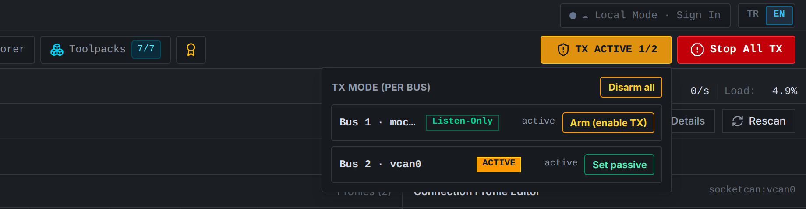
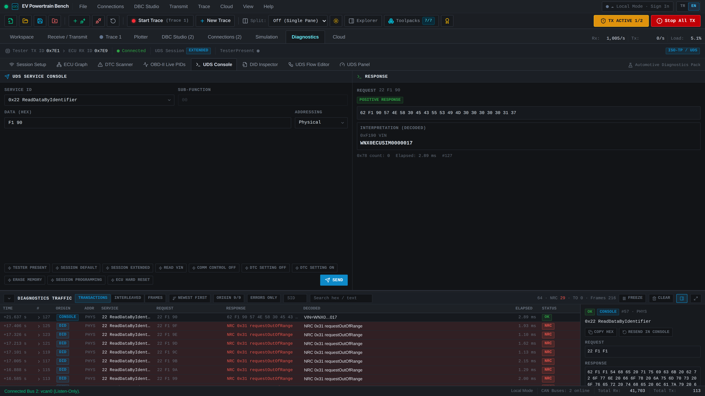
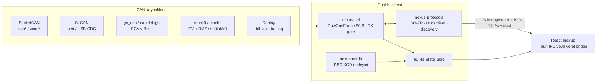

<div align="center">

# NexusCAN

[English](./README.md) · **Türkçe**

**Açık kaynak CAN / CAN-FD analiz aracı. UDS Diagnostics ve Reverse Engineering özellikleriyle.**<br/>
Rust · Tauri v2 · MIT lisanslı

[](https://github.com/kadirtunc/NexusCAN/stargazers)
[](https://github.com/sponsors/kadirtunc)
[](./LICENSE)


<table>
<tr>
<td width="50%"></td>
<td width="50%"></td>
</tr>
<tr>
<td align="center"><sub><b>Bus Analysis</b>: canlı DBC/KCD çözümleme, CAN-FD, multiplexer, değişen bayt vurgusu.</sub></td>
<td align="center"><sub><b>UDS Diagnostics</b>: tek fonksiyonel istek atılıyor, dört ECU cevap veriyor.</sub></td>
</tr>
</table>

<sub>Ekran görüntüleri gerçek uygulamadan alındı. Sanal ağ üzerinde çalışıyor (<code>vcan0</code> + <a href="tests/hil/ecusim">ecusim</a> ECU'ları + dahili EV/BMS simülatörü), aşağıdaki adımlarla aynısını kendiniz kurabilirsiniz.</sub>

</div>

---

## Neden yaptım

Piyasadaki ticari CAN araçları iyi ama pahalı ve kapalı. Açık kaynak olanlar trafik dinlemek için yeterli, fakat iş diagnostics tarafına gelince yetersiz kalıyor. NexusCAN'i bu ikisinin arasındaki boşluk için yazdım: önce sağlam bir CAN analiz aracı, üstüne de aynı altyapıyı kullanan bir diagnostics ortamı.

Öne çıkan noktalar:

- **Performance.** Frame'ler sabit 80 baytlık yapılarda tutuluyor, RX/TX tarafında heap tahsisi yok. Arayüz her frame için değil, saniyede 60 kez toplu güncelleniyor. Testlerde saniyede 50.000 frame'de kayıp yok.
- **DBC Support.** `.dbc` ve `.kcd` dosyaları üç aşamada derleniyor: Intel ve Motorola bit düzeni, signed ve float sinyaller, kademeli multiplexer, 64 baytlık CAN-FD mesajları, J1939 PGN'leri.
- **Safety.** Kanallar varsayılan olarak **Listen-Only** açılıyor, yani hatta hiçbir şey göndermiyor. Göndermek için **Arm** edip onaylamak gerekiyor. **Stop All TX** butonu her ekranda var.
- **Diagnostics.** Bus'taki ECU'ları bulup haritaya diziyor. Birine tıklayınca giden istekleri, gelen cevapları, NRC'leri ve ISO-TP frame'lerini hangi işleme ait olduklarıyla birlikte görüyorsunuz.
- **Reverse Engineering.** Bit bazında Heatmap, Baseline/Action karşılaştırması, Field Classifier, OBD-II ile Correlation ve Cheat Engine mantığında Value Scan. Bulduğunuz sinyali direkt DBC'ye kaydedebiliyorsunuz.
- **No fake data.** Demo modu açıkça işaretli. Onun dışında hiçbir ekran uydurma değer göstermiyor.

---

## İndirme

Hazır kurulum dosyaları **[Releases](https://github.com/kadirtunc/NexusCAN/releases)** sayfasında. Her sürüm, üç işletim sisteminde tüm testler geçtikten sonra otomatik olarak yayınlanıyor.

| Platform | Dosya |
| :--- | :--- |
| Windows 10/11 x64 | `*_x64-setup.exe` (kurulum), `*.msi`, `*_x64_portable.exe` (kurulumsuz) |
| Linux x86_64 | `*.AppImage` (`chmod +x` verip çalıştırın), `*.deb`, `*.rpm` |
| macOS (Apple Silicon) | `*_aarch64.dmg` |

Dosyalar henüz imzalı değil. Windows'ta SmartScreen uyarısında "Yine de çalıştır" demeniz gerekiyor. macOS'ta uygulamayı kopyaladıktan sonra bir kere `xattr -cr /Applications/NexusCAN.app` çalıştırın. Her sürümle birlikte `SHA256SUMS.txt` de geliyor.

---

## Features

### Bus Analysis


**Trace**: Gelen frame'ler zaman sırasıyla, sinyalleri çözümlenmiş olarak listeleniyor (multiplexer'lar, E2E sayaç ve CRC'leri dahil). Kayıtları farklı hızlarda tekrar oynatabilirsiniz. `.trc`, `.asc`, `.blf`, `.log` ve `.csv` içe/dışa aktarılabiliyor.

<table>
<tr>
<td width="50%"></td>
<td width="50%"></td>
</tr>
<tr>
<td><b>Plotter</b>: Çok eksenli canlı grafikler, imleçler, genel bakış şeridi. Trace'ten seçtiğiniz sinyali direkt çizdirebilirsiniz.</td>
<td><b>DBC Studio</b>: Mesajın bayt/bit yerleşimi (Intel ve Motorola), her sinyalin ölçeği, ofseti, aralığı ve anlık değeri.</td>
</tr>
</table>

- **Receive / Transmit** (en üstteki görüntü): Her ID tek satırda güncelleniyor, sinyaller ve periyotlar canlı görünüyor. Ham veya sinyal bazlı frame'leri tek seferlik ya da periyodik gönderebilirsiniz. Değerler DBC'deki min/max aralığına kırpılıyor.
- **Error Frames**: Bit, stuff, form, ACK, CRC hataları ve error-passive / bus-off geçişleri okunabilir şekilde gösteriliyor. Frame'leri metin olarak kopyalayıp yapıştırabilirsiniz.
- **Connections Dock**: Bağlı bus'lar adaptörü, modu ve durumuyla alt panelde listeleniyor.
- **Debug Console**: Backend ve arayüz olaylarını kategorilere ayırarak gösteren, ayrı pencereye alınabilen bir konsol.
- **Simulation Panels**: DBC sinyallerine bağlanan sürükle-bırak göstergeler (ibre, LED, grafik, buton, slider). İsterseniz veritabanından otomatik taslak da oluşturabilirsiniz.

### Safety



TX durumu üst çubukta her zaman görünüyor. Disarm anında gerçekleşiyor, arm etmek ise onay istiyor. **Stop All TX** tüm periyodik gönderimleri iptal ediyor, bütün bus'ları disarm ediyor ve diagnostics bağlantılarını kapatıyor. O anda gönderilmekte olan frame'in bitmesini bekliyor (en fazla 250 ms). Bu, `vcan0` üzerinde bağımsız bir dinleyiciyle test edildi: 1000 denemede, Stop'tan sonra hatta tek bir frame bile çıkmadı.

- **Hardware Listen-Only (opsiyonel)**: *Require hardware Listen-Only* açıksa, sadece yazılımsal kilit sunabilen bir adaptör hiç açılmıyor. Her bus'ın yanında gerçekte hangi korumanın olduğu yazıyor: donanım, yazılım veya sanal.
- **Adaptörlere körü körüne güvenilmiyor**: SLCAN sürücüsü, adaptörün listen-only komutuna verdiği cevabı gerçekten kontrol ediyor. Sanal SocketCAN arayüzleri de isminden değil, kernel bilgisinden tespit ediliyor.

### UDS Diagnostics


**ECU Graph**: Fonksiyonel tarama (11-bit veya 29-bit) ile ECU'ları buluyor, VIN, parça no, seri no ve SW/HW versiyonlarını otomatik okuyor. Her ECU'nun DTC sayısı ve oturumu görünüyor. Harita kaydediliyor ve her taramada güncelleniyor.


**Traffic Dock**: Tüm Diagnostics sekmelerinin altında duran ortak bir panel. Görselde 203 baytlık bir `22 F1 F1` cevabı `SF → FF → FC → 29 × CF` frame'lerine açılmış durumda. Sağ tarafta çözümlenmiş veri ve **P2 / STmin zamanlama kontrolleri** var. İşlem, zaman çizelgesi ve ham frame olmak üzere üç görünümü var.

<table>
<tr>
<td width="50%"></td>
<td width="50%"></td>
</tr>
<tr>
<td><b>DID Inspector</b>: ISO 14229-1 Annex C kimlik DID'lerinin tamamı (F180–F19F). ASCII ve BCD tarih çözümleme. ECU'nun desteklemediği DID'lerde gelen NRC olduğu gibi gösteriliyor.</td>
<td><b>UDS Console</b>: İstediğiniz servisi fiziksel veya fonksiyonel adreslemeyle gönderebilirsiniz. Cevaplar diğer ekranlarla aynı şekilde çözümleniyor.</td>
</tr>
</table>

- **Passive Discovery**: Hatta hiçbir şey göndermeden, sadece trafiği dinleyerek tester ↔ ECU çiftlerini buluyor. Listen-Only modunda da çalışıyor.
- **Physical Sweep**: Aktif tarama yapmak isterseniz ID'leri tek tek deniyor. Stop veya disarm olursa o ana kadarki sonuçla duruyor. 11-bit, 29-bit ve ISO 15765-2 adresleme formatları destekleniyor.
- **DTC Reports**: `0x19` ReadDTCInformation rapor tipleri ve klasik `19 02` taraması, durum maskeleri çözümlenmiş olarak.
- **ECU Flashing**: `34` / `36` / `37` servisleriyle flash akışı. Bootloader simülatörü ve `vcan0` üzerinde uçtan uca testleri var. Yükleme sırasında Stop'a basarsanız sonrasında hiçbir silme veya yazma yapılmıyor.
- **SecurityAccess**: Seed/key profilleri ve dahili algoritmalar. Üreticinin `GenerateKeyEx` DLL'leri ayrı bir yardımcı süreçte (32 veya 64 bit) çalışıyor, DLL çökse bile uygulama etkilenmiyor. Harici program ve HTTP servisi de kullanılabiliyor.
- **ECU Registry**: Araçlar, gruplar ve ECU'lar (adresleme, oturum, güvenlik ayarları) proje içinde saklanıyor. `.nexusecu.json` olarak içe/dışa aktarılabiliyor.
- **Flow Editor**: Görsel blok editörü. Değişken, matematik, mantık, döngü, metin, UDS, flash ve log blokları var. Akışlar Simulink bloğu gibi giriş/çıkış portlarıyla çalışıyor. Seçtiğiniz blokları tek bir özel bloğa dönüştürüp tekrar kullanabilirsiniz. Her kayıt ayrı bir sürüm olarak saklanıyor.
- **Workbench**: Satırlarda aracın ECU'ları, sütunlarda onlara bağlı bloklar var. Bir hücreyi çalıştırıp sonucunu ve çıktılarını görüyorsunuz. Her çalışmanın kaydı (parametreler, dosyalar, çıktılar, log) proje bazında saklanıyor.
- **Diagnostic Simulation**: UDS DID'lerine veya OBD-II PID'lerine bağlanan, kaydedilebilir gösterge panelleri. Run'a basmadan hiçbir sorgu gönderilmiyor.
- **OBD-II**: Mode 01 canlı PID'ler.

### Reverse Engineering

Dokümantasyonu olmayan sinyalleri bulmak için ayrı bir sekme. Tamamen pasif çalışıyor, hatta hiçbir şey göndermiyor. Canlı bus'ta da Demo verisiyle de kullanılabiliyor.

- **Heatmap**: Her ID bir satır, her bayt sekiz hücre. Renk, bitin ne sıklıkla değiştiğini gösteriyor. Hücrelerin altında bit değerleri ve baytın hex karşılığı yazıyor. CAN-FD'de 512 bitin tamamı görünüyor.
- **Baseline → Action**: Araçta hiçbir şey yapmadan bir *Baseline* kaydı alıyorsunuz. Sonra butona basarken veya kapıyı açarken *Action* kaydı alıyorsunuz. Ekranda sadece sizin hareketinizle değişen bitler kalıyor. Sayaçlar, checksum'lar ve sensör gürültüsü otomatik eleniyor. `M` tuşuyla zaman çizelgesine işaret koyabilirsiniz.
- **Field Classifier**: Sabit bitleri, sayaçları (2/4/8 bit), checksum'ları (XOR8, SUM8, CRC8 SAE-J1850, CRC8 AUTOSAR), bayrakları ve fiziksel değerleri otomatik buluyor. Her ID'nin periyodunu ve jitter'ını gösteriyor.
- **Signal Inspector**: Izgarada bitleri seçiyorsunuz, farklı yorumlarını (uzunluk, Intel/Motorola, signed/unsigned, float, ölçek) aynı anda grafikte görüyorsunuz.
- **Correlation**: Bus'tan okunan bir OBD-II PID'i (örneğin hız), koyduğunuz işaretler veya başka bir sinyal referans alınıyor. Frame'deki bütün olası bit kombinasyonları deneniyor (klasik bir frame için yaklaşık 6.200 aday, ~0,1 saniyede). En iyi eşleşmeler ölçek ve ofsetleriyle birlikte sıralanıyor. ±500 ms'ye kadar gecikme de tespit ediliyor.
- **Save to DBC**: Bulduğunuz sinyali isim, ölçek, birim ve değer tablosuyla taslak olarak kaydediyorsunuz. *Apply to bus* ile taslaklar `RE_found.dbc` olarak yükleniyor, trace ve grafiklerde hemen çözümleniyor. Ayrı bir `.dbc` dosyası olarak dışa aktarabilir veya mevcut DBC'nize yeni dosya olarak ekleyebilirsiniz.
- **Value Scan**: Cheat Engine'deki gibi çalışıyor. Bir değer arıyorsunuz (örneğin 80 km/h), araçta bir şeyi değiştiriyorsunuz, sonra *arttı / azaldı / değişti / değişmedi* diye daraltıyorsunuz. Birkaç adımda doğru sinyal kalıyor. Değerleri ondalık veya `0x` hex girebilirsiniz. Son sekiz adım geri alınabiliyor. Bir milyon aday yaklaşık 50 ms'de taranıyor.

### AI Co-pilot (MCP Server)

Uygulamanın içinde bir [Model Context Protocol](https://modelcontextprotocol.io) sunucusu var. Claude Code gibi bir AI asistanı bu sayede analizörün gördüğü veriyi okuyup sorularınıza cevap verebiliyor: *"Bus 0'da en yoğun ID'ler hangileri?"*, *"BMS_Status sinyalini son 10 saniye için özetle"*, *"Bu oturumdaki DTC cevaplarını yorumla"*, *"Son iki kaydı karşılaştır"*.

Sunucu **varsayılan olarak kapalı**. Durum çubuğundaki `MCP` göstergesinden başlatıyorsunuz, panelin kopyaladığı komutla da istemcinizi bağlıyorsunuz:

```bash
claude mcp add --transport http nexuscan http://127.0.0.1:17800/mcp \
  --header "Authorization: Bearer <TOKEN>"
```

Sekiz grupta **46 salt-okunur araç** var:

| Grup | Araç | Asistan ne yapabiliyor |
| :--- | :---: | :--- |
| Live | 9 | Uygulama ve bus durumu, cihazlar ve sürücüler, canlı mesaj tablosu, canlı sinyal değerleri ve istatistikleri, periyodik TX listesi, son trace penceresi |
| Trace | 4 | Kayıtları listeleme, özetleme ve sorgulama, bir sinyali zaman serisi olarak çıkarma |
| Database | 8 | Yüklü DBC/KCD bilgisi, sinyal arama, mesajlar ve ECU'lar, frame çözme / kodlama, parser uyarıları |
| Diagnostics | 4 | UDS oturum bilgisi, istek/cevap akışı, ISO-TP frame'leri, pasif ECU keşfi |
| Reverse Engineering | 6 | Heatmap durumu, bit serileri, korelasyon, Value Scan sonuçları, DBC taslağı üretme |
| Workspace | 4 | Projeler, trace karşılaştırma, Debug Console olayları |
| Runs & Flows | 4 | Workbench çalıştırma geçmişi, flow kütüphanesi |
| UI Co-pilot | 7 | Arayüz durumunu okuma, sekme değiştirme, mesaj seçme, Trace filtresi, Plotter'a sinyal ekleme, bildirim gösterme, size evet/hayır sorusu sorma |

**Güvenlik.** Hiçbir MCP aracı hatta veri gönderemiyor, bus'ı arm edemiyor, bus modunu değiştiremiyor, UDS servisi çalıştıramıyor, flash yapamıyor, seed/key hesaplayamıyor, replay başlatamıyor veya dosya yazamıyor. Listen-Only ve Panic Stop'a dokunulmuyor. Sunucu yalnızca `127.0.0.1`'i dinliyor, her başlatmada yeni ve rastgele bir token istiyor, loopback olmayan `Host`/`Origin` başlıklarını reddediyor. Her çağrı Debug Console'a (`MCP` kategorisi) yazılıyor, SecurityAccess / Authentication verisi gizleniyor. Ana pencere kapanınca sunucu da duruyor. Açıklamalarıyla tam araç listesi için MCP panelindeki ⓘ butonuna tıklayın.

---

## Donanım olmadan denemek

Gerekenler: SocketCAN destekli Linux (`vcan` ve `can-isotp` modülleri), Rust ve Node.js 20+.

```bash
git clone https://github.com/kadirtunc/NexusCAN.git && cd NexusCAN

# 1. Sanal CAN bus ve dört sanal UDS ECU (genel, BMS, inverter, şarj cihazı)
sudo ./scripts/setup_vcan.sh
sudo modprobe can-isotp
make -C tests/hil/ecusim
cd tests/hil/ecusim
./build/ecusim -i vcan0 -c config/manual.json           --req 0x7E0 --resp 0x7E8 --func 0x7DF &
./build/ecusim -i vcan0 -c config/manual-bms.json       --req 0x7E1 --resp 0x7E9 --func 0x7DF &
./build/ecusim -i vcan0 -c config/manual-inverter.json  --req 0x7E5 --resp 0x7ED --func 0x7DF &
./build/ecusim -i vcan0 -c config/manual-charger.json   --req 0x7E7 --resp 0x7EF --func 0x7DF &
cd ../../..

# 2. Backend ve arayüz (ikisi de sadece 127.0.0.1'de çalışır)
cargo run --release -p nexus-hal --bin nexus_bridge &
npm install && npm run dev        # tarayıcıda http://localhost:5173
```

Sonra: **Create project → Connections → Add Test Simulator (mock0)** ile simüle EV/BMS trafiğini açın. **SocketCAN `vcan0`** ekleyin, sağ üstteki **TX** butonundan arm edin ve **Diagnostics → ECU Graph → Scan Bus** ile ECU'ları tarayın.

> Masaüstü uygulaması (Tauri) aynı arayüzü ve backend'i kullanıyor. Kurulum dosyaları [Releases](https://github.com/kadirtunc/NexusCAN/releases) sayfasında.

---

## Mimari



| Crate | Görevi |
|---|---|
| `nexus-core` | `RawCanFrame` (80 bayt, 64 baytlık CAN-FD verisi), zaman damgası |
| `nexus-hal` | Adaptör sürücüleri, Listen-Only / Arm / Panic Stop kontrolü, diagnostics (discovery, sweep, DTC, flash), replay, 60 Hz veri akışı, Reverse Engineering motoru |
| `nexus-netdb` | `.dbc` / `.kcd` derleyici, sinyal çözümleme ve kodlama, DBC yazıcı |
| `nexus-protocols` | UDS client, ECU discovery, ISO-TP, SAE J1939 (PGN, BAM/CMDT, adres talebi, DM1/DM2), flash akışı |
| `nexus-seedkey-native` / `-host` | SecurityAccess anahtar sağlayıcıları (üretici DLL'lerini ayrı süreçte çalıştırır) |
| `nexus-ecu-sim` | Testler için UDS ECU ve bootloader simülatörü |
| `nexus-cli` | Arayüzsüz çalışan ajan (her zaman Listen-Only) |

---

## Durum

NexusCAN şu an **v0.1 önizleme** aşamasında. Neyin hazır, neyin yolda olduğu:

| Alan | Hazır | Sırada |
|---|---|---|
| Adapters | SocketCAN (Linux), SLCAN (tüm işletim sistemleri), mock simülatörler, dosyadan oynatma. **gs_usb / candleLight** (sürücü kurulumu gerektirmez) ve **PCAN-Basic** sürücüleri yazıldı. | gs_usb ve PCAN için gerçek donanım testleri, Kvaser, Vector XL |
| Safety | Varsayılan Listen-Only, opsiyonel Hardware Listen-Only, onaylı Arm, Stop All TX | Tüm adaptörlerde donanım Listen-Only doğrulaması |
| Diagnostics | UDS client, ECU Graph, Passive Discovery, Physical Sweep, Traffic Dock, DID / DTC / UDS Console, OBD-II, flash, seed/key, ECU kayıtları, Flow Editor, Workbench, Diagnostic Simulation | Workbench'te toplu çalıştırma ve rapor, çok ECU'lu akışlar, ODX/CDD |
| Recording | Trace kaydı ve replay, BLF/ASC/TRC/CSV/candump | Tetiklemeli kayıt, ASAM MF4 |
| Reverse Engineering | Heatmap, Baseline/Action, Field Classifier, Signal Inspector, Correlation, Save to DBC, Value Scan | Kayıtlı log üzerinde analiz, iki log karşılaştırma, seçici replay, aktif tarayıcılar |
| Protocols | UDS (ISO 14229), ISO-TP (ISO 15765-2), SAE J1939 | J1939 arayüzü, CANopen, XCP |
| Platforms | Linux (test edildi), tarayıcı modu; Windows, Linux ve macOS (Apple Silicon) kurulum dosyaları | Kod imzalama, Intel Mac sürümü |
| Experimental | NexusCloud istemcisi ve ajan: kodu repoda, **yayınlanan sürümlerde kapalı** | NexusCloud sunucusu, ajan sürümleri |

### İleride (deneysel)

- **NexusCloud** *(açık kaynak, kendi sunucunuzda)*: Ekip için ortak DBC kütüphanesi, paylaşılan kayıtlar.
- **NexusCAN Agent**: Test tezgâhlarını ve araçları uzaktan izlemek için. Her zaman Listen-Only, uzaktan veri göndermek tasarım gereği yok.

---

## Teşekkürler

NexusCAN'in arkasında bu projelerin emeği var:

- **[linux-can / can-utils](https://github.com/linux-can/can-utils)** ve SocketCAN ekibi
- Collin Kidder'ın **[SavvyCAN](https://github.com/collin80/SavvyCAN)** projesi
- Nick Kirkby'nin **[driftregion/iso14229](https://github.com/driftregion/iso14229)** kütüphanesi: projedeki sanal ECU'ların tamamı bunun üzerinde çalışıyor
- **[`automotive`](https://github.com/I-CAN-hack/automotive)**: UDS istemcisinin ISO-TP / UDS altyapısı
- Pier-Yves Lessard'ın **[udsoncan](https://github.com/pylessard/python-udsoncan)** ve **[can-isotp](https://github.com/pylessard/python-can-isotp)** kütüphaneleri: sanal ECU'lar bunlarla çapraz doğrulanıyor
- **[candleLight / gs_usb](https://github.com/candle-usb/candleLight_fw)** açık donanım topluluğu
- **[cantools](https://github.com/cantools/cantools)**, **[canmatrix](https://github.com/ebroecker/canmatrix)** ve **[Kayak](https://github.com/dschanoeh/Kayak)**
- **[PlotJuggler](https://github.com/facontidavide/PlotJuggler)**
- **[Tauri](https://github.com/tauri-apps/tauri)**, **[Tokio](https://github.com/tokio-rs/tokio)**, **[Rhai](https://github.com/rhaiscript/rhai)**, **[React](https://github.com/facebook/react)** ve Rust / web ekosistemi

Desteği için ayrıca teşekkürler: **[@emrylmzkk](https://github.com/emrylmzkk)**

Lisanslarıyla birlikte tam liste: [ACKNOWLEDGMENTS.md](./ACKNOWLEDGMENTS.md)

---

## Katkı

Issue ve PR'lara açığım. Özellikle şunlar çok işe yarar:
- Donanım testleri (Windows / macOS'ta gs_usb, PCAN, Kvaser)
- Protokol tecrübesi (J1939, CANopen, ODX)
- Gerçek araçlardan alınmış trace dosyaları

Proje Claude Code ile yapay zekâ destekli olarak geliştiriliyor. Protokol tarafı `vcan0`, ISO-TP kernel soketleri ve `ecusim` test ortamıyla doğrulanıyor.

## İletişim

NexusCAN işinize yaradıysa **[GitHub Sponsors](https://github.com/sponsors/kadirtunc)** üzerinden destek olabilirsiniz. Gelen destek test donanımlarına (gs_usb, PCAN, Kvaser, gerçek UDS ECU'ları) ve geliştirmeye gidiyor.

**İş teklifi, sponsorluk, iş birliği veya ticari destek** için: **[kdrtnc35@gmail.com](mailto:kdrtnc35@gmail.com)**

Hata ve öneriler için lütfen [GitHub issue](https://github.com/kadirtunc/NexusCAN/issues) açın, böylece cevaptan herkes faydalanır. Güvenlik açığı bildirmek için [SECURITY.md](./SECURITY.md) dosyasına bakın.

## Yıldız geçmişi

<a href="https://star-history.com/#kadirtunc/NexusCAN&Date">
  
</a>

## Lisans

[MIT](./LICENSE) © Kadir Tunç

<sub>NexusCAN bağımsız bir açık kaynak projesidir. Vector Informatik, PEAK-System, Kvaser, ETAS, Bosch veya SAE International ile bir bağlantısı yoktur. Ürün adları sahiplerinin ticari markalarıdır.</sub>
