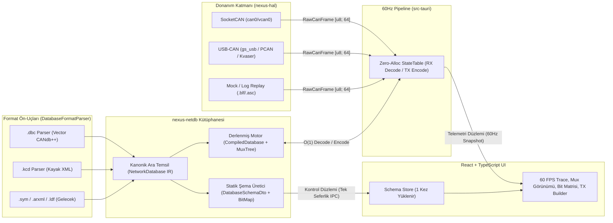

# ROLE & OBJECTIVE
You are a Principal Systems Architect & Embedded Automotive Engineer. Build **"NexusCAN"** (codename *CanScope*) — a next-generation, high-throughput CAN / CAN-FD bus analyzer, multi-format network database (`.dbc`, `.kcd`, etc.) signal engine, and telemetry tool built with **Tauri v2 (Modular Rust Workspace Backend + React/TypeScript/TailwindCSS Frontend)**.

The foundational goal is to read high-speed CAN / CAN-FD traffic across pluggable hardware interfaces (starting with Linux `SocketCAN` `vcan0` / `can0` and a built-in High-Speed Mock Generator, architected for `PCAN`, `Kvaser`, `gs_usb`, `SLCAN`, and log replay), decode and encode signals in real-time using a standalone, production-grade **Signal Database Parser & Codec Library (`nexus-netdb`)** supporting `.dbc`, `.kcd`, and future formats, and render a sleek, dark-mode industrial UI at a rock-solid **60 FPS** without IPC bottlenecks.

---

# 1. ARCHITECTURAL CONSTRAINTS (STRICT)
1. **Zero-Allocation Frame Struct:** Never use `Vec<u8>` for CAN frame payloads in the hot path. Use a stack-allocated fixed array `[u8; 64]` (supporting both Classical CAN 8-byte and CAN-FD 64-byte frames) inside a cache-aligned `#[repr(C)]` struct.
2. **Two-Layer Hardware Abstraction Layer (`nexus-hal`):** Separate **Device Discovery & Capability Probing** (`AdapterDriver` trait) from **Hot-Path Frame I/O** (`CanChannel` / `CanAdapter` trait). Future hardware (`PCAN-Basic` FFI, `Kvaser CANlib`, `gs_usb` via `nusb`, `SLCAN`, `.blf`/`.asc` trace replay) must plug in without touching the pipeline, signal engine, or UI. Every frame carries a `bus_id: u8` to allow simultaneous multi-channel / multi-device operation.
3. **Zero-Bottleneck 60Hz Decimation:** NEVER emit an IPC event per incoming CAN frame. A dedicated Rust reader thread pushes frames into a lock-free/bounded ring buffer (`crossbeam-channel` bounded or `rtrb`). A state aggregator updates an in-memory `StateTable` (computing cycle time `dt_ms`, frequency `Hz`, frame count, byte-change bitmasks, multiplexer branch retention, and decoded physical/enum values). The UI receives compact telemetry snapshots at strictly **60Hz (every 16.6ms)**.
4. **Format-Agnostic Signal Database Library (`nexus-netdb`):** Build a standalone, zero-Tauri-dependency Rust library crate using a **3-Stage Compiler Architecture**:
   - **Stage 1 — Pluggable Format Frontends (`DatabaseFormatParser` trait):** Native, complete parsers for `.dbc` (Vector CANdb++) and `.kcd` (Kayak XML), extensible to `.sym`, `.arxml`, and `.ldf`.
   - **Stage 2 — Canonical Intermediate Representation (`NetworkDatabase` IR):** Format-independent domain model normalizing Intel/Motorola bit numbering, signed/unsigned/IEEE-754 float/double types, standard & cascaded/range multiplexers (`M`, `mX`, `mXM`, `SG_MUL_VAL_`), value tables/enums, ECU nodes, comments, and attributes (`GenMsgCycleTime`, `VFrameFormat`, J1939 PGNs).
   - **Stage 3 — Compiled Runtime Codec (`CompiledDatabase`):** Pre-computed `FxHashMap` + J1939 mask lookup + `MuxDecisionTree` for deterministic, zero-allocation bitwise RX extraction and TX frame packing.
5. **Two-Plane Backend-to-UI Data Contract:** Separate static database metadata (**Schema Plane**, sent once on DB load as `DatabaseSchemaDto` including pre-calculated bit-layout matrices, units, comments, min/max, and enum tables) from live values (**Telemetry Plane**, streamed at 60Hz using compact `SignalId` keys), eliminating redundant string serialization on the hot path.

---

# 2. WORKSPACE & DIRECTORY STRUCTURE
```text
NexusCAN/
├── Cargo.toml                         # Workspace root (crates/* + src-tauri)
├── scripts/
│   ├── setup_vcan.sh                  # Creates vcan0 and optionally runs cangen
│   ├── sample_vehicle.dbc             # Sample EV DBC (Intel/Motorola, Mux, Float, Enums, Attributes)
│   └── sample_bms.kcd                 # Sample Kayak (.kcd) database for multi-format verification
├── crates/
│   ├── nexus-core/                    # Zero-alloc core primitives (no OS/UI deps)
│   │   ├── Cargo.toml
│   │   └── src/
│   │       ├── lib.rs
│   │       ├── frame.rs               # RawCanFrame ([u8; 64]), CanId (Std/Ext), FrameFlags, BusId
│   │       └── time.rs                # Monotonic microsecond clock utilities
│   ├── nexus-hal/                     # Hardware Abstraction Layer crate
│   │   ├── Cargo.toml
│   │   └── src/
│   │       ├── lib.rs                 # AdapterDriver, CanChannel traits, Capabilities, BusHealth
│   │       ├── registry.rs            # Driver registry, device enumeration & hotplug manager
│   │       └── drivers/
│   │           ├── socketcan_drv.rs   # Linux SocketCAN (can*, vcan*, CAN + CAN-FD)
│   │           └── mock_drv.rs        # Deterministic 1kHz-50kHz synthetic EV & Mux traffic generator
│   └── nexus-netdb/                   # Standalone Signal Database Parser & Codec Library
│       ├── Cargo.toml
│       └── src/
│           ├── lib.rs                 # Public API, FormatRegistry, multi-DB merge
│           ├── error.rs               # DbParseError & non-fatal ParseDiagnostic (line/col/severity)
│           ├── ir/                    # Stage 2: Format-Agnostic Canonical IR
│           │   ├── mod.rs             # NetworkDatabase, BusDef, EcuNode, MessageDef, SignalDef
│           │   ├── mux.rs             # MuxRole, MuxSwitchId, MuxRange (standard & cascaded)
│           │   └── attrs.rs           # AttributeValue, ValueTable, CycleTime, FrameProtocol
│           ├── formats/               # Stage 1: Pluggable File Format Parsers & Exporters
│           │   ├── mod.rs             # DatabaseFormatParser & DatabaseFormatExporter traits
│           │   ├── encoding.rs        # UTF-8 / Windows-1252 / ISO-8859-1 auto-transcoding
│           │   ├── dbc/               # Full Vector CANdb++ (.dbc) parser
│           │   │   ├── mod.rs
│           │   │   ├── lexer.rs       # Zero-copy / fast token scanner
│           │   │   ├── parser.rs      # BO_, SG_, SG_MUL_VAL_, SIG_VALTYPE_, VAL_, CM_, BA_, SIG_GROUP_
│           │   │   └── writer.rs      # Optional canonical DBC export
│           │   └── kcd/               # Kayak CAN Definition (.kcd XML) parser
│           │       └── mod.rs         # Streaming XML -> Canonical IR mapper
│           ├── compiler/              # Stage 3: IR -> Runtime Execution Plan
│           │   ├── mod.rs             # CompiledDatabase, J1939 PGN mask index, validation
│           │   ├── bit_plan.rs        # Normalized Intel & Motorola sawtooth bit-span compiler
│           │   └── mux_tree.rs        # DAG / Decision-tree compiler for nested multiplexers
│           ├── codec/                 # Deterministic Zero-Alloc Bitwise Engine
│           │   ├── extractor.rs       # RX: &[u8; 64] -> raw/physical/float/enum values
│           │   └── encoder.rs         # TX: physical/raw signal inputs -> [u8; 64] payload packer
│           └── ui_dto.rs              # DatabaseSchemaDto & 64-byte visual BitLayoutMatrix builder
├── src-tauri/
│   ├── Cargo.toml
│   └── src/
│       ├── main.rs
│       ├── lib.rs
│       ├── commands.rs                # Tauri IPC commands (DB load, HAL control, TX) & 60Hz Channel
│       └── pipeline/
│           ├── mod.rs                 # Multi-bus Reader threads + Aggregator orchestration
│           └── state_table.rs         # Per-(Bus, ID) state, dt_ms/Hz, byte-diff, mux-retained signals
└── src/
    ├── main.tsx
    ├── App.tsx
    ├── types/
    │   ├── hal.ts                     # Device descriptors, capabilities, bus health DTOs
    │   ├── netdb.ts                   # DatabaseSchemaDto, MessageSchemaDto, SignalSchemaDto, BitCellDto
    │   └── telemetry.ts               # 60Hz BusSnapshotDto, FrameStateDto, LiveSignalValueDto
    ├── store/
    │   └── databaseStore.ts           # Indexed O(1) lookup store for loaded .dbc / .kcd schemas
    └── components/
        ├── TopBar.tsx                 # Device/Channel selector, Bitrate/FD config, DB loader (.dbc/.kcd), Metrics
        ├── FixedTraceTable.tsx        # Overwrite view: Bus, ID, Name, DLC, Cycle/Watchdog, Hex diff, Mux & Signals
        ├── DatabaseExplorer.tsx       # Full ECU/Message/Signal tree, Attributes, Enums, Parse Diagnostics
        ├── BitLayoutMatrix.tsx        # Interactive 8x8 / 64x8 Intel & Motorola bit-map visualizer
        └── SignalInspector.tsx        # Pinned live signal cards & Signal-based Frame TX Composer
```

---

# 3. CORE BACKEND SPECIFICATIONS

## A. Key Rust Dependencies
- **Workspace Shared:** `serde`, `serde_json`, `thiserror`, `rustc-hash` (`FxHashMap`), `indexmap`, `parking_lot`, `crossbeam-channel`.
- **`nexus-netdb`:** `winnow` or `nom` (deterministic zero-copy DBC parsing), `encoding_rs` (Windows-1252 / Latin-1 / UTF-8 transcoding), `quick-xml` (fast `.kcd` XML parsing), `smallvec` (inline signal/range storage without heap thrashing).
- **`nexus-hal` (Linux target):** `[target.'cfg(target_os = "linux")'.dependencies]` -> `socketcan = "3"`, `nix`.
- **`src-tauri`:** `tauri = "2"`.

## B. `crates/nexus-core/src/frame.rs` & `crates/nexus-hal` (Hardware Abstraction Layer)
Define cache-friendly, zero-allocation core primitives and two-level hardware traits:

```rust
#[repr(C)]
#[derive(Clone, Copy, Debug)]
pub struct RawCanFrame {
    pub timestamp_us: u64,   // Monotonic microseconds
    pub arb_id: u32,         // Clean 11-bit (0..0x7FF) or 29-bit (0..0x1FFF_FFFF) CAN ID
    pub bus_id: u8,          // Logical channel/bus ID (0..255) for multi-device routing
    pub dlc: u8,             // Payload byte length (0..=8 for CAN, up to 64 for CAN-FD)
    pub flags: u8,           // Bit0: Extended, Bit1: RTR, Bit2: FD, Bit3: BRS, Bit4: ESI, Bit5: Error, Bit6: TX
    pub _reserved: u8,       // Explicit alignment padding (total struct size = 80 bytes exact)
    pub data: [u8; 64],      // Fixed stack buffer, zero heap allocation
}

pub trait AdapterDriver: Send + Sync {
    fn driver_id(&self) -> &'static str; // e.g., "socketcan", "mock", "pcan", "gs_usb", "slcan"
    fn display_name(&self) -> &'static str;
    fn discover_devices(&self) -> Result<Vec<DeviceDescriptor>, AdapterError>;
    fn open_channel(
        &self,
        device: &DeviceDescriptor,
        config: &ChannelConfig,
    ) -> Result<Box<dyn CanChannel>, AdapterError>;
}

pub trait CanChannel: Send {
    fn descriptor(&self) -> &DeviceDescriptor;
    fn capabilities(&self) -> &AdapterCapabilities;
    fn close(&mut self) -> Result<(), AdapterError>;
    /// Reads up to `out_batch.len()` frames into pre-allocated slice. Returns count read.
    fn recv_batch(&mut self, out_batch: &mut [RawCanFrame], timeout_ms: u32) -> Result<usize, AdapterError>;
    fn send_frame(&mut self, frame: &RawCanFrame) -> Result<(), AdapterError>;
    fn set_filters(&mut self, filters: &[CanFilter]) -> Result<(), AdapterError>;
    fn health(&self) -> BusHealthSnapshot;
}
```
Auto-discover available Linux `vcan*`, `can*`, and `slcan*` interfaces via `/sys/class/net`, plus always expose `"mock0 (Synthetic EV + Multiplexed BMS 25kfps)"` for instant hardware-free verification.

## C. `src-tauri/src/pipeline/state_table.rs` (Hot Path Aggregator)
For every unique `(bus_id, can_id_key)`:
- Track `last_timestamp_us`, `smoothed_cycle_ms` (EMA filter: `0.85 * old + 0.15 * new_dt`), `total_count`, and `changed_bytes_mask: u64` (bits `0..63` set where `new_data[i] != old_data[i]` within the last `300ms` for 64-byte CAN-FD highlighting).
- Compare `smoothed_cycle_ms` against `CompiledMessage::expected_cycle_ms` (from DBC `GenMsgCycleTime` / KCD `interval`) to compute `CycleHealth` (`Nominal`, `JitterWarning`, `Timeout`).
- Look up the message in the bus's bound `CompiledDatabase`. Decode active signals in-place and update the message's **Signal State Slots** (retaining last-known values of inactive multiplexer branches alongside their `last_updated_us` timestamp, while marking `active_in_current_frame = true` on the currently selected branch).
- Track global & per-bus metrics: `frames_per_sec`, `estimated_bus_load_pct`, `active_ids_count`, `total_frames_rx`, `dropped_frames`.

---

# 4. FRONTEND UI SPECIFICATIONS (`src/`)
Design a sleek, high-contrast dark industrial UI (`bg-[#0B0F17]`, borders `border-slate-800`, monospace numbers `font-mono tabular-nums`):

1. **Top Control Bar:**
   - Multi-device Interface Dropdown (`vcan0`, `can0`, `mock0`, future USB adapters) with capability badges (`CAN-FD`, `Listen-Only`) + Connect/Disconnect button with pulsing green status LED.
   - **"Load Network DB"** button supporting `.dbc` and `.kcd` files (multi-DB attachment per bus + Parse Diagnostics indicator badge showing warnings if vendor files have non-fatal quirks).
   - Live Telemetry Badges: `FPS (Frames/s)`, `Bus Load %`, `Total Frames`, `Active IDs`, `DB Signals Mapped`.
2. **Main Fixed-State Table (PCAN-View Style Overwrite Table):**
   - Columns: Expand Chevron, Bus, CAN ID (`0x101` Std / `0x18FF50E5` Ext), Message Name & Transmitter ECU (from DB or `"Unknown"`), Format Badge (`CAN` / `FD` / `J1939`), DLC, Cycle Time (`ms` / `Hz` + Timeout alert), Count, Raw Payload (`0..DLC` hex bytes).
   - **Byte Change Highlighting:** Any byte whose bit is set in `changed_bytes_mask` renders with an amber/cyan highlight badge so active bytes jump out immediately.
   - **Expandable Signal & Multiplexer Drawer:** Clicking a row expands its decoded signals inline:
     - Displays active Multiplexor Switch badge (e.g., `MUX: BankSelector = 2`) with a toggle for **"Current Mux Branch"** vs **"All Retained Mux Branches"**.
     - Shows Signal Name (with comment tooltip), **Physical Value** (bold cyan) + **Enum Label Badge** (e.g. `"2 — Fault"` from `VAL_`), Unit, Raw Hex/Int, Min/Max range status, and a sleek mini horizontal progress bar.
     - Quick tab to open the **Bit-Layout Matrix** (`8x8` or `64x8` grid showing Intel/Motorola bit spans visually).
3. **Database Explorer & Signal TX Composer:**
   - Searchable sidebar/modal listing all loaded ECUs, Messages, Signals, Attributes, and Value Tables from `.dbc` / `.kcd`.
   - **Signal-Level Frame Transmitter:** Pick any DB message, type physical values or select enum states in dropdowns, auto-pack via `nexus-netdb` encoder, and transmit single-shot or periodic frames.

---

# 5. MODÜL 1 — SİNYAL VERİTABANI PARSER KÜTÜPHANESİ (`nexus-netdb`), ÜST DÜZEY SOYUTLAMA VE UI ENTEGRASYONU

Bu bölüm, projenin kalbinde yer alan sinyal çözümleme/kodlama kütüphanesinin (`crates/nexus-netdb`), cihaz/dosya soyutlama katmanlarının ve UI veri köprüsünün uçtan uca teknik mimarisini tanımlar.

## 5.1. Mimari Felsefe: Neden 3 Katmanlı Derleyici (Compiler) Yaklaşımı?
Farklı CAN cihazları (`SocketCAN`, `PCAN`, `gs_usb`, `Kvaser`, `SLCAN`) ve farklı veritabanı formatları (`.dbc`, `.kcd`, ileride `.sym`, `.arxml`, `.ldf`) destekleneceği için sistem **LLVM benzeri 3 aşamalı bir soyutlama hattı** kullanır:



1. **Tauri'den Tam Bağımsızlık:** `nexus-netdb` içinde hiçbir UI veya Tauri bağımlılığı bulunmaz. Tek başına `cargo test` ve `cargo bench` ile test edilebilir; masaüstü uygulamasında, gömülü Linux IoT ağ geçidinde (headless) veya WebAssembly (`wasm32`) hedefinde doğrudan çalışabilir.
2. **Format Kusurlarının İzolasyonu:** `.dbc` içindeki Motorola MSB bit numaralandırması, `0x80000000` Extended ID bayrağı veya `Windows-1252` karakter kodlaması ile `.kcd` içindeki XML tabanlı tanımlamalar **Stage 1'de** çözülür ve **Kanonik IR (`NetworkDatabase`)** katmanına tek bir standart matematiksel model olarak iner. Çalışma zamanı (`extractor.rs` / `encoder.rs`) ve React UI, verinin `.dbc`'den mi yoksa `.kcd`'den mi geldiğini bilmek zorunda kalmaz.

---

## 5.2. Desteklenmesi Zorunlu Tüm DBC & Sinyal İşlemleri (Tam Kapsam Matrisi)

Hazır basit kütüphanelerin çoğunun tökezlediği gerçek dünya otomotiv/EV senaryolarının tamamı `nexus-netdb` tarafından eksiksiz desteklenir:

### 1. Byte Sıralaması (Endianness) ve Bit Matematiği (`0..512` Bit / CAN-FD 64-Byte)
- **Little-Endian / Intel (`@1`):**
  - `start_bit`, sinyalin **En Düşük Anlamlı Bitini (LSB)** gösterir.
  - Bitler ardışık olarak yukarı doğru (`start_bit .. start_bit + bit_len`) ilerler ve byte sınırlarını doğrusal geçer.
- **Big-Endian / Motorola (`@0` — Vector Sawtooth Numaralandırması):**
  - DBC standardında `SG_` içindeki `start_bit`, sinyalin **En Yüksek Anlamlı Bitini (MSB)** gösterir.
  - Bit ilerleyişi byte içinde MSB'den LSB'ye (`7 -> 0`) doğru iner; `bit_in_byte == 0` sınırından bir sonraki daha düşük anlamlı bite geçerken **bir sonraki byte'ın 7. bitine** (`(byte_idx + 1) * 8 + 7`) sıçrar (Sawtooth kuralı).
  - `.kcd` gibi farklı bit ofseti kuralı kullanan formatlar okunurken derleyici (`bit_plan.rs`) tüm sinyalleri ortak `NormalizedBitSpan` dizisine dönüştürür.
- **CAN-FD 64-Byte Güvencesi:** Tüm yükü tek bir `u64`'e cast eden (ve 8 byte üstünde çöken) yaklaşımlar **kesinlikle yasaktır**. Çıkarıcı (`extractor.rs`), `&[u8]` (maks. 64 byte = 512 bit) üzerinde keyfi başlangıç bitinden (`0..511`) `1..=64` bit uzunluğundaki her sinyali sıfır tahsisle (zero-allocation) okur ve yazar.

### 2. Veri Tipleri ve İşaret Uzatma (Value Types)
- **Unsigned Integer (`+`):** `1..=64` bit işaretsiz tam sayı (`u64`).
- **Signed Integer (`-`):** `1..=64` bit ikinin tümleyeni (two's complement) işaretli tam sayı (`let shift = 64 - bit_len; ((raw << shift) as i64) >> shift`).
- **IEEE-754 Single Float (`SIG_VALTYPE_ <id> <sig> : 1;`):** 32-bit kayan noktalı sayı (`f32::from_bits(raw as u32) as f64`), hem Intel hem Motorola byte diziliminde.
- **IEEE-754 Double Float (`SIG_VALTYPE_ <id> <sig> : 2;`):** 64-bit çift duyarlıklı kayan noktalı sayı (`f64::from_bits(raw)`), hem Intel hem Motorola byte diziliminde.
- **Boolean (1-bit Flag) & Raw Opaque Bytes:** Durum bayrakları ve ham diziler.

### 3. Multiplexing (Standart, Kaskad/İç İçe ve Aralık Tabanlı)
- **Statik Sinyaller (`MuxRole::Static`):** Mesaj her geldiğinde her zaman çözülür.
- **Ana Multiplexor Seçici (`M` — `MuxRole::MasterSwitch`):** Hangi alt sayfanın aktif olduğunu belirleyen seçici sinyal.
- **Basit Multiplexed Sinyaller (`m0`, `m1`, `m255`):** Seçici sinyalin ham değeri `N` olduğunda aktifleşen sinyaller.
- **Genişletilmiş / Kaskad Multiplexing (`m<N>M` ve `SG_MUL_VAL_`):**
  - Bir sinyalin hem üst bir seçiciye bağlı olması hem de kendisinin alt sinyaller için alt-seçici (`SubSwitch`) olması durumu (iç içe/nested ağaç yapısı).
  - `SG_MUL_VAL_ <msg_id> <muxed_sig> <switch_sig> <min1>-<max1>, <min2>-<max2>;` sözdizimi ile tekil değer yerine **çoklu değer aralıklarında** (`0-3, 10-15` gibi) aktifleşme.
  - **Derleme Zamanı Doğrulaması:** `mux_tree.rs`, kaskad bağlantılarda döngü (cycle) olup olmadığını kontrol eder ve çalışma zamanında `O(1)` / ikili arama ile sadece aktif daldaki sinyalleri çözen bir `MuxDecisionTree` üretir.
- **UI İçin Kritik "Retained Mux State" (Sayfa Hafızası) Özelliği:**
  - Örneğin bir EV Batarya Yönetim Sistemi (BMS), `0x105` mesajında `Mux = 0..23` üzerinden 96 hücre voltajını sırayla gönderir. Sadece son paketteki 4 hücreyi göstermek diğer 92 hücrenin ekranda kaybolmasına/titremesine yol açar.
  - `StateTable`, bir mesajın **tüm mux dallarındaki sinyallerin son bilinen değerlerini** ve güncellenme zamanını (`last_updated_us`) hafızada tutar; aynı zamanda hangilerinin son pakette güncellendiğini (`is_active_branch: bool`) işaretler.

### 4. Fiziksel Dönüşüm, Sınır Denetimi ve Değer Tabloları (`VAL_` / `VAL_TABLE_`)
- **Lineer Ölçekleme:** `physical = (raw as f64) * factor + offset`.
- **Min / Max Sınır Kontrolü:** `[min|max]` aralığı dışına çıkan değerler için `out_of_range: bool` bayrağı üretilir (ancak `0|0` şeklinde tanımlanmamış DBC sınırlarında yanlış alarm üretilmez).
- **Durum / Enum Açıklamaları (`VAL_` & `VAL_TABLE_`):** Ham tam sayı değerlerinin metin karşılıkları (örn. `0 -> "Init"`, `1 -> "Drive"`, `2 -> "Regen"`, `15 -> "SNA / Fault"`). UI'da hem sayısal değer hem enum etiketi birlikte gösterilir.

### 5. CAN ID Adresleme, CAN-FD, J1939 PGN ve Tam DBC Grameri
- **11-bit Standard vs 29-bit Extended ID Ayrımı:** DBC içindeki `0x80000000` (31. bit) bayrağı ayrıştırılarak `CanId::Standard(u16)` ve `CanId::Extended(u32)` tiplerine dönüştürülür (`0x100` Standard ile `0x00000100` Extended asla çakışmaz).
- **`VECTOR__INDEPENDENT_SIG_MSG` (`3221225472` / `0xC0000000`) Yönetimi:** Bağımsız/yetim sinyaller aktif CAN ID tablosunu kirletmeden IR içinde ayrı bir koleksiyonda saklanır.
- **SAE J1939 PGN Maskeleme:** `VFrameFormat == "J1939PG"` olan 29-bit mesajlarda Priority ve Source Address bitlerini maskeleyerek PGN (`0x03FFFF00` / PDU1-PDU2 kuralları) üzerinden eşleştirme desteği (ağır vasıta, şarj istasyonu CCS/CHAdeMO ve endüstriyel inverter uyumu).
- **Tam Meta-Veri Desteği:**
  - Ağ düğümleri (`BU_`), çoklu göndericiler (`BO_TX_BU_`), alıcı ECU listeleri.
  - Açıklama/Yorumlar (`CM_` — Ağ, ECU, Mesaj ve Sinyal bazlı çok satırlı yorumlar).
  - Özel Nitelikler (`BA_DEF_`, `BA_DEF_DEF_`, `BA_`, `BA_REL_`): `GenMsgCycleTime` (beklenen periyot ms), `GenSigStartValue` (başlangıç değeri), `VFrameFormat` (`StandardCAN`, `ExtendedCAN`, `StandardCAN_FD`, `ExtendedCAN_FD`, `J1939PG`), `SystemSignalLongSymbol` (32 karakter sınırını aşan uzun sinyal adları).
  - Sinyal Grupları (`SIG_GROUP_` — E2E CRC / Counter gruplamaları) ve Ortam Değişkenleri (`EV_`).
- **Karakter Kodlaması Dayanıklılığı (`encoding.rs`):** UTF-8 olmayan (`Windows-1252` / `ISO-8859-1` ile kaydedilmiş `°C`, `µA`, `Ω`, Almanca/Türkçe karakter içeren) endüstriyel `.dbc` dosyaları otomatik algılanıp kayıpsız UTF-8'e dönüştürülür.
- **Hata Toleranslı Tanılama (`ParseDiagnostic`):** Kusurlu üretici DBC'lerinde (örn. DLC'yi aşan sinyal biti, eksik noktalı virgül, çakışan sinyal bitleri) tüm dosyayı reddetmek yerine satır/sütun numaralı `Warning` / `Error` raporu üretilerek UI'a iletilir.
- **Çift Yönlü Kodlama (`encoder.rs` — TX Frame Packing):** Fiziksel değerden ham değere (`raw = round((physical - offset) / factor)`), sınır kırpma (clamping), aktif mux seçici değerini otomatik yazma ve Intel/Motorola bit paketleme işlemleriyle `[u8; 64]` CAN/CAN-FD çerçevesi üretimi.

---

## 5.3. Soyutlama Katmanı ve Veri Modelleri (`crates/nexus-netdb`)

```rust
/// Yeni dosya formatları (.dbc, .kcd, .sym, .arxml, .ldf) yalnızca bu trait'i implemente eder.
pub trait DatabaseFormatParser: Send + Sync {
    fn format_id(&self) -> &'static str;                  // "dbc", "kcd"
    fn supported_extensions(&self) -> &'static [&'static str]; // &["dbc"], &["kcd"]
    fn sniff(&self, header_bytes: &[u8]) -> bool;         // İçerikten otomatik format tanıma
    fn parse(&self, bytes: &[u8], opts: &ParseOptions) -> Result<ParsedDatabaseBundle, DbParseError>;
}

#[derive(Clone, Copy, Debug, PartialEq, Eq, Hash, Serialize, Deserialize)]
pub enum CanIdKey {
    Standard(u16),
    Extended(u32),
}

#[derive(Clone, Copy, Debug, PartialEq, Eq, Serialize, Deserialize)]
pub enum ByteOrder {
    LittleEndian, // Intel (@1)
    BigEndian,    // Motorola (@0)
}

#[derive(Clone, Copy, Debug, PartialEq, Eq, Serialize, Deserialize)]
pub enum SignalValueType {
    Unsigned,
    Signed,
    Float32,
    Float64,
}

#[derive(Clone, Debug, Serialize, Deserialize)]
pub enum MuxRole {
    Static,
    MasterSwitch,
    Multiplexed {
        switch_signal: SignalId,
        ranges: Vec<MuxRange>, // Tekil değerler (N..=N) ve SG_MUL_VAL_ aralıkları (min..=max)
        is_sub_switch: bool,   // m<N>M kaskad mux durumu
    },
}

/// Çalışma zamanında sıfır-tahsisli (zero-alloc) çözümleme yapan derlenmiş sinyal planı
#[derive(Clone, Debug)]
pub struct CompiledSignal {
    pub id: SignalId,                  // Yoğun (dense) u32 indeks -> UI şemasıyla O(1) eşleşir
    pub start_bit: u16,                // 0..511
    pub bit_len: u8,                   // 1..=64
    pub byte_order: ByteOrder,
    pub value_type: SignalValueType,
    pub factor: f64,
    pub offset: f64,
    pub min: f64,
    pub max: f64,
    pub has_bounds: bool,
    pub has_enum_table: bool,
}
```

---

## 5.4. UI Veri Aktarım Mimarisi (Kontrol Düzlemi vs. 60Hz Telemetri Düzlemi)

UI tarafında hem `.dbc` / `.kcd` içindeki en ince detayların (yorumlar, birimler, ECU'lar, enum tabloları, bit haritası, mux ağacı) eksiksiz gösterilmesi hem de 50.000 fps CAN trafiğinde **sıfır IPC darboğazıyla 60 FPS** akıcılığın korunması için veri aktarımı iki düzleme ayrılır:

### Düzlem 1: Statik Şema Düzlemi (`DatabaseSchemaDto` — Dosya Yüklendiğinde 1 Kez Gönderilir)
Kullanıcı bir `.dbc` veya `.kcd` yüklediğinde Tauri komutu (`cmd_load_database`) dosyayı ayrıştırır, derler ve önyüze şu zengin şemayı tek seferde döner (`src/types/netdb.ts`):
- **`DatabaseInfoDto`:** Dosya adı, format (`"dbc"` | `"kcd"`), karakter kodlaması, protokol özeti, ayrıştırma uyarıları (`diagnostics: ParseDiagnosticDto[]`).
- **`EcuNodeDto[]`:** Ağdaki tüm ECU'lar, yorumları, gönderdiği ve dinlediği mesaj ID'leri.
- **`MessageSchemaDto[]`:** `messageKey`, `arbId`, `isExtended`, `protocol` (`CAN` | `CAN_FD` | `J1939`), `name`, `dlc`, `transmitters`, `expectedCycleMs`, `comment`, `muxTree`, `signalGroups`, ve **önceden hesaplanmış `bitLayout: BitCellDto[]`** (Frontend'in Motorola sawtooth hesabı yapmadan doğrudan `8x8` veya `64x8` bit matrisini boyayabilmesi için her sinyalin hangi byte/bit hücrelerini kapladığının hazır haritası).
- **`SignalSchemaDto[]`:** `signalId: number`, `name`, `longName`, `startBit`, `bitLength`, `byteOrder`, `valueType`, `factor`, `offset`, `min`, `max`, `unit`, `receivers`, `comment`, `muxRole`, `enumTable: Record<string, string>`, `initialValue`.

### Düzlem 2: Canlı Telemetri Düzlemi (`TelemetrySnapshotDto` — Saniyede 60 Kez `ipc::Channel` İle Akar)
Her `16.6ms`'de akan pakette statik metinler (sinyal adı, birim, yorum, enum tablosu) **tekrar gönderilmez**; yalnızca `signalId` üzerinden eşleşen hafif sayısal durumlar taşınır (`src/types/telemetry.ts`):
- **`FrameTelemetryDto`:** `busId`, `arbId`, `flags`, `dlc`, `rawBytes`, `changedBytesMask` (`u64` / `[u32, u32]`), `cycleMs`, `cycleHealth` (`Nominal` | `Late` | `Timeout`), `rxCount`, `activeMuxSwitches: Record<number, number>`.
- **`LiveSignalDto`:** `signalId`, `rawValue` (`number | string` 64-bit tam hassasiyet için), `physicalValue: number`, `activeInLastFrame: boolean` (aktif mux dalı mı yoksa hafızadaki son değer mi?), `outOfRange: boolean`, `ageMs: number`.
- React tarafındaki `databaseStore`, gelen `signalId`'yi `O(1)` dizi/Map erişimiyle `SignalSchemaDto` ile birleştirerek sinyal adını, birimini, min/max çubuğunu ve `enumTable[rawValue]` etiketini anında ekrana basar.

---

# 6. UYGULAMA STRATEJİSİ (FAZ PLANI)

Projeyi en yüksek kod kalitesi ve modülerlikle hayata geçirmek için geliştirme şu sıralı fazlarda yürütülür:

1. **Faz 1 — Workspace İskeleti + `nexus-core` + `nexus-netdb` (Parser & Codec Kütüphanesi):**
   Cargo workspace yapısını kur; `nexus-netdb` altında `.dbc` ve `.kcd` ayrıştırıcılarını, Kanonik IR'yi, Intel/Motorola + Float + Kaskad Multiplexer (`SG_MUL_VAL_`) çözücü/kodlayıcı motorunu, `DatabaseSchemaDto` üreticisini ve kapsamlı birim testlerini (`cargo test -p nexus-netdb`) tamamla.
2. **Faz 2 — `nexus-hal` + 60Hz Pipeline (`src-tauri`):**
   `AdapterDriver` ve `CanChannel` soyutlamalarını, Linux `socketcan` (`vcan0`/`can0`) ve çoklu-mux destekli `mock0` sürücülerini, `StateTable` (mux hafızalı) ve 60Hz Tauri `Channel` akışını yazıp derle.
3. **Faz 3 — Endüstriyel Dark UI (`src/`):**
   `DatabaseSchemaDto` store yapısını, byte değişim vurgulu ve multiplexer destekli `FixedTraceTable`'ı, `BitLayoutMatrix` görselleştiricisini, `DatabaseExplorer`'ı ve sinyal tabanlı TX göndericisini inşa et.

---

# 7. LINUX'TA `vcan0` HATTINI TEST ETMEK İÇİN HAZIR KOMUTLAR

```bash
# 1. Çekirdekte sanal CAN ve CAN-FD uyumlu vcan0 arayüzünü kaldır
sudo modprobe vcan
sudo ip link add dev vcan0 type vcan
sudo ip link set vcan0 mtu 72   # CAN-FD (64-byte) çerçevelerini de desteklemesi için MTU=72
sudo ip link set up vcan0

# 2. (Seçenek A) Rastgele yüksek hızlı trafik bas (Her 1 ms'de 1 frame = 1000 fps)
cangen vcan0 -g 1 -I i -L 8 -D r

# 3. (Seçenek B) Örnek DBC'deki 0x101 (BMS) ve 0x102 (Motor) ID'lerine hedefli trafik bas
cangen vcan0 -g 2 -I 101 -L 8 -D r &
cangen vcan0 -g 2 -I 102 -L 8 -D r &
```
